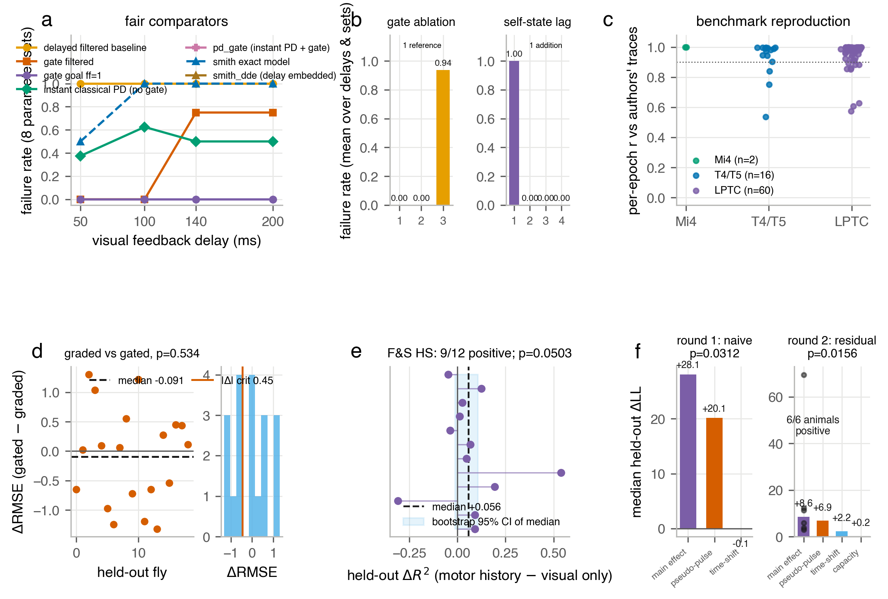
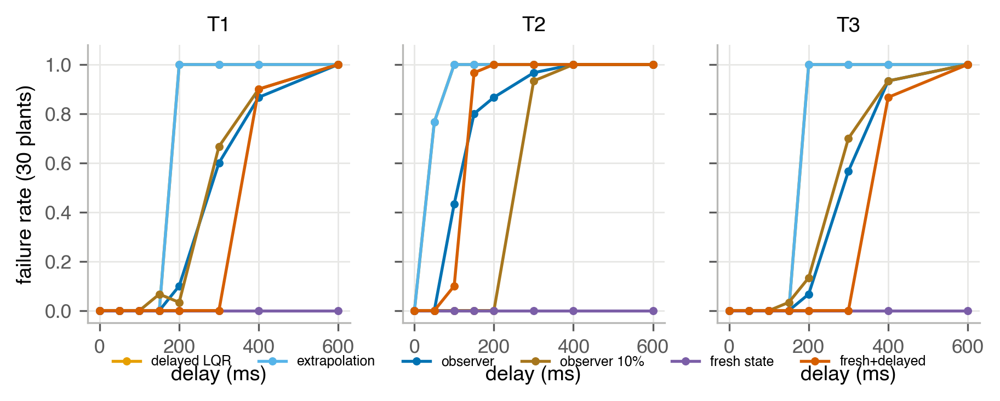

# What delayed feedback control needs: fresh state, conditional gating, and tests across artificial and biological systems

## Abstract

Latency in the feedback loop is a shared problem for biological and artificial agents: a delayed estimate describes a state that has already moved. In a ported Drosophila steering model we ask what a delayed controller needs and whether it transfers. Systematic elimination yields a bounded necessity structure. Within this model class and its enumerated architectures, fresh current self-state in the closing loop is the fundamental necessary ingredient; gating substitutes when that pathway cannot receive fresh state; and delayed-only estimation never rescued stability, from second-order extrapolation to delay-embedding observers. The ordering transferred under preregistration to three non-biological tasks: fresh-state feedback held through 600 ms of delay, delayed-observation controllers collapsed between 50 and 200 ms. Four public neural-behavioral datasets set empirical constraints; all confirmatory analyses were preregistered with frozen files and hashes. The result is a bounded, cross-domain account of one information requirement, its limits stated rather than implied.

**Subject terms:** delayed feedback control; state estimation; sensorimotor latency; intelligent agents; evaluation methodology

## Introduction

Feedback controllers that act on delayed sensory measurements face a common problem: by the time a measurement arrives, the state it describes has moved. This is true of flying insects, legged robots, teleoperated systems, and autonomous agents that carry latency in their sensing pipeline. Across these fields three families of solution have been proposed. A controller may cancel the delayed consequences of self-motion with an internal copy of the motor command (efference copy or corollary discharge); it may suppress or gate the delayed pathway while fast, self-generated corrections run; or it may lean on rapid non-visual feedback that stabilizes the slower visual loop. Each family has empirical support somewhere. In the fly, the third family is well documented: antennal feedback acts on a roughly 20 to 100 ms timescale and stabilizes optomotor behavior; motion-sensitive descending and neighboring circuits carry signals related to self-motion; and behavioral suppression by visual context has been reported at multiple processing levels. What has not been settled is the computational necessity structure, which is a distinct question from whether any one family works: which piece of information is actually required to stabilize a delayed controller, what an estimator can and cannot replace, and how much of the corresponding signature real neural circuits show when examined with appropriately controlled analyses. Conflating these questions has produced both over-claims and premature dismissals. We work them through one concrete system in depth, the fruit fly's visual steering, because it offers a rare combination: an explicit control-model tradition, matched-genetic interventions, and an unusually rich set of public neural-behavioral datasets.

**Scope of this work.** We state what this paper does and does not establish. It establishes: a bounded necessity map within one model class and a preregistered transfer of that map's ordering to three artificial control tasks; a quantified confound (behavioral autocorrelation) and a sensitivity-calibrated fix for state-dependent perturbation analyses; and empirical constraints from four public datasets, reported whether favorable or not. It does not establish: any biological mechanism claim, any formal stability theorem, or an impossibility result for delayed estimation beyond the observer classes tested. The biological layers are constraint-setting case studies for a computational and methodological contribution, not the contribution's headline.

We address them in three layers. First, in a delayed steering model ported from a published flight simulator, we exhaustively compare the solution classes above, including strong classical-control alternatives: forward-model (Smith-style) observers that see only delayed observations, instantaneous classical proportional-derivative control with matched gains and plant structure, and gating ablations at matched information. Second, we take the model's surviving claims to four public neural-behavioral datasets (a visual counter-evidence dataset with behavior and imaging at five cell-type levels, simultaneous HS-cell intracellular recordings and wing-beat signals during flight, a walking-steering dataset with a genuine optogenetic intervention axis, and a multisensory orientation dataset under a sealed preregistered round) and test what the data can and cannot say, with preregistration, negative controls, and animal-level statistics throughout. Third, we report the methodological result that emerged from the intervention analyses: tests of state-dependent perturbation responses are powerfully confounded by generic behavioral autocorrelation, and we quantify how much of the confound a residual pipeline removes and what remains.

Every empirical outcome is reported regardless of direction, including inconclusive and negative results; all confirmatory analyses were preregistered with frozen analysis files and hashes. The result is a map of necessity in the model, of signal in the data, and of the distance between them.


## Results

### A minimal steering model and five variants

We used the flight-simulator equations of Canelo et al. (2024) as the starting point. The fly's heading error is corrected by a bar pathway that responds to the angular position and velocity of a target, and by a grating pathway that responds to wide-field background motion. The body is a second-order yaw system with moment of inertia `I` and drag `beta`. The bar torque is low-passed with `tau_bar = 0.05 s`, the grating torque with `tau_opto = 0.04 s`, and the grating gain is `k_opto = 25 x 10^-12 N m` per rad/s.

We introduced a delay `d` by evaluating the visual state at time `t - d`: the bar angle and its derivative, the grating angle and its derivative, the heading, and the angular velocity. The body state and the torque low-pass filters remain at the current time. This is a deliberately simple transport delay. It is not a full delay differential equation treatment, but it captures the essential loop: visual information about the current state arrives late. The heading and angular velocity are treated as visually sensed body states; delaying them is an assumption, not a claim about proprioception.

We compared five variants:

- **addition:** bar and grating torques are summed; no efference copy.
- **graded filtered:** a fixed-gain internal prediction `omega_ec` is driven by the filtered bar-torque state `F_bar` and subtracted from the grating drive.
- **graded unfiltered:** the same graded architecture, but `omega_ec` is driven by the instantaneous bar-pathway output computed from the current visual state.
- **gate filtered:** the grating gain is set to zero when the filtered bar torque exceeds a threshold.
- **gate unfiltered:** the grating gain is set to zero when the instantaneous bar-pathway output exceeds a threshold.

The labels "filtered" and "unfiltered" are deliberate. The unfiltered variants are not copies of an issued motor command. They are bar-pathway signals computed from the current visual state, and they therefore differ from the filtered variants in both timing and filtering. The comparison tests the effect of signal timing and filtering, not a sensory-versus-motor distinction.

All variants share the body, sensory time constants, bar and grating stimuli, integration step, and failure criterion. The only differences are the efference-copy architecture and the signal used by the gate.

### Efference-copy gain: the source's fixed gain is inert; higher delayed-sensory gain is harmful

We swept the graded efference-copy gain from 0 to 1.0 at delays of 0.02, 0.05, 0.10, and 0.20 s across 12 parameter sets (1,440 simulations; Fig. 2). The source's fixed graded implementation uses a gain of 0.05 on the bar torque in its Figure 5 code, so we treat 0.05 as the reference gain.

At gain 0 or 0.05, both graded variants were indistinguishable from addition at every delay. At 50 ms, all three failed in 75% of parameter sets. At gains of 0.25 or more, delayed-sensory cancellation became harmful. Failure at 50 ms rose to 100% (12/12), while addition remained at 75% (9/12). At gains of 0.75 or 1.0, failure at 20 ms also rose, from 42% to 50%.

The unfiltered graded variant behaved differently at the short 2.5 s window. At gains of 0.5 or more, its 200 ms failure was 25% to 42%. At unity gain, extending the window to 6 s raised the 200 ms failure to 62.5%. We therefore do not treat it as a robust long-delay advantage.

These regimes are not a monotonic effect of gain. A strong delayed-sensory estimate adds a delayed feedback loop, which destabilizes the system. A strong unfiltered drive can provide a lead signal at long delays, but it also overshoots at short delays. The source's fixed gain of 0.05 sits in the inert regime. It is too weak to either help or hurt. This is the first main result: the effect of graded cancellation is not a property of "graded versus gating" alone. It depends on the gain and on the filtering of the signal.

### Gating prevents failure at short delays

We next asked whether gating prevents failure at delays where the continuous models fail. At a 6 s window, with eight parameter sets and two noise seeds, gating was perfect at 20 and 50 ms. `gate filtered` and `gate unfiltered` both failed in 0 of 16 runs at 20 and 50 ms. Addition failed in 75% and 100% of runs at those delays, graded filtered in 87.5% and 100%, and graded unfiltered in 75% and 62.5% (Fig. 3).

At 100 ms, the picture changed. `gate filtered` failed in 0% of runs at 2.5 and 6 s, but in 18.8% at 10 s. `gate unfiltered` failed in 0%, 6.2%, and 6.2% at the same windows. Addition and graded filtered failed in 100% of runs at 100 ms in every window; graded unfiltered failed in 62.5%, 75%, and 75%. At 140 ms, `gate filtered` failed in 18.8%, 68.8%, and 75% at 2.5, 6, and 10 s, while `gate unfiltered` failed in 75% at all three windows. At 200 ms, both gating variants failed in 75% of runs at the 6 s window, and addition and graded filtered failed in 100%.

The defensible claim is therefore narrow. Gating prevents the early failures that continuous models show at 20 to 50 ms. It buys time at 100 ms, but the advantage is small and window-dependent. It does not provide an asymptotic stability advantage at 140 ms or longer.

### The long-delay gating claim was a window artifact

An earlier version of this analysis used a 2.5 s window and reported that `gate filtered` failed in only 3 of 16 runs at 140 ms. That number was a window artifact. When the same 16 runs were integrated to 6 s, 11 failed. At 10 s, 12 failed. `gate unfiltered` failed in 12 of 16 at all three windows. The 140 ms comparison therefore does not support a gating advantage (Fig. 3).

The same window check changes the interpretation of the 200 ms critical delay. At 200 ms, `gate filtered` failed in 75% of runs at 6 s, and `gate unfiltered` also failed in 75%. The earlier median of 200 ms was a censored first-failure time, not a stability boundary. We no longer report a 200 ms critical delay for gating.

### The 100 ms advantage depends on the V-term treatment and gate threshold

We tested whether the short-delay gating advantage is an artifact of the bar-velocity V term. The source's V term becomes negative for heading errors above `sqrt(10)` rad, which is inside the large-excursion regime that determines failure. We compared the original hard clip (`max(0, 20 - 2 error^2)`), a smooth saturating form (`20 / (1 + (error/3.162)^4)`), and the unclipped source form at a 6 s window (Fig. 4, left).

At 20 and 50 ms, the failure rates were identical across the three V treatments. Gating remained at 0%, and the continuous models remained at 62.5% to 100%. At 100 ms, the treatments diverged. `gate filtered` failed in 0% with the clip, 75% with the smooth form, and 0% with the unclipped form. `gate unfiltered` failed in 6.2%, 75%, and 6.2%. At 140 and 200 ms, failure was 62.5% to 100% under all three treatments; the lowest cell is graded unfiltered at 200 ms (62.5% in all three), and `gate filtered` at 140 ms is 68.8% under clip and unclipped.

We also swept the gate threshold from 0.01 to 0.5 of the bar-torque scale at the same 6 s window, for both gating signals. For `gate filtered`, gating remained at 0% across every threshold and both the clip and smooth V treatments at 20 and 50 ms. The second signal, `gate unfiltered`, matched these zeros everywhere at 20 and 50 ms except one corner: threshold 0.5 under clip, where it failed in 25% of runs at 50 ms (and in 62.5% at 100 ms, versus 37.5% for `gate filtered`). At 100 ms for `gate filtered`, the clip treatment produced 0% failure for thresholds below 0.5 and 37.5% at 0.5, while the smooth treatment produced 75% at every threshold. At 140 ms, every threshold and treatment produced 75% failure.

The short-delay gating advantage is therefore robust to gate threshold and V treatment. The 100 ms advantage is not. It requires the hard clip and a threshold below 0.5, and it disappears under a smooth V term.

### Adaptive updates do not rescue delay

An earlier analysis used the source's squared-error update and concluded that adaptation learned a higher gain and failed. The source update uses a non-negative squared error, so the gain can only increase. We therefore compared three update rules at a 6 s window: the source-style squared error, a signed-error gradient, and a signed-error gradient with the opposite sign (Fig. 5).

The source-style update drove the mean gain from 0.51 at 20 ms to 1.05 at 200 ms. Failure was 50% at 20 ms and 100% at 50, 100, and 200 ms. The signed gradient kept the mean gain lower, from 0.22 at 20 ms to 0.40 at 200 ms. Failure was unchanged: 50% at 20 ms and 100% at the longer delays. The opposite-sign control also left failure unchanged, with a mean gain of 0.11 to 0.38.

Adaptation therefore does not rescue bounded steering at 50 ms in this architecture, whether the gain is allowed to rise monotonically or is updated with a signed error. The learned gain changes, but the failure boundary does not. We do not claim that all adaptive controllers fail. We claim that this MLP, with this oracle bar-only target, does not rescue the delay problem. To check that the negative result is not an artifact of updating the weights between solver steps, we re-implemented the update by integrating the weights as states of the differential equation with a rate matched to the discrete step. Across 96 paired runs (four delays, two update rules, twelve parameter sets), the two forms agreed on failure classification and failure time in every pair. Before the runs diverge, trajectory differences stay at floating-point scale in most pairs, with exceptions up to 0.21 rad (source rule) and 4.1 rad (gradient rule) at 20 ms, where the runs themselves diverge anyway; none of these prefix differences changed a failure classification.

### The source's zero-delay ranking is not reproduced

The source's behavioral result is motivation for comparing the model families, not a validation of our implementation. In a zero-delay check with our bar and grating step, the ratio of peak heading at high versus low grating gain was 0.9148 for addition, 0.9830 for gate filtered, 0.9996 for graded unfiltered, and 0.9998 for graded filtered. Graded cancellation was at least as invariant to grating gain as gating in this setting, which does not reproduce the source's ranking.

We also ran a check with the source's scaled parameters, a constant grating angle, and grating gains of 0.05 and 0.7. At a near-zero gate threshold, gate filtered was invariant (59.956 versus 59.956 degrees) by construction, because the gate is effectively always closed. At the main threshold used in this paper, gate filtered was about 4% sensitive (59.890 versus 57.422 degrees). Graded cancellation at a gain of 0.5 was about 0.3% sensitive (59.923 versus 59.770 degrees), and addition was 15% sensitive (59.846 versus 50.846 degrees). The source's ranking is therefore not recovered at a meaningful effect size. The model is a stylized two-pathway assay inspired by the source, not a faithful extension of it.

### A true command copy does not rescue delay

To separate a command copy from plant-state feedback, we added a pre-plant-filter command signal `u_t`, computed from the same delayed visual estimate that drives the controller, and used its copy for the efference copy or gate. At a 6 s window and gain 1.0, graded command and graded filtered had identical failure rates: 87.5% at 20 ms and 100% at 50, 100, 140, and 200 ms (Fig. 6, left). Gate command and gate filtered also had identical failure rates: 0% at 20, 50, and 100 ms and 75% at 140 and 200 ms. The command gate had a lower duty cycle (0.35, 0.65, 0.79, 0.82, 0.85) than the filtered gate (0.44, 0.78, 0.85, 0.87, 0.87), but this did not change failure (Fig. 6, right). The only variant with lower failure at long delays was the old unfiltered oracle, which uses the current visual state (75%, 62.5%, 75%, 75%, and 62.5% at 20 to 200 ms). Its apparent benefit is therefore an oracle effect, not a motor-copy effect. The source question closes: in this architecture, a true command copy does not rescue delay. The graded-family identity and the gate-goal zeros reproduce identically in all three seeds of a multi-seed re-run (24 parameter-seed combinations per cell). The gate pair is not identical at the run level: `gate filtered` drifts by one or two runs across seeds (0%, 0%, 12.5% at 100 ms; 75%, 62.5%, 62.5% at 140 ms) while `gate command` is 0% and 75% in every seed, a drift that does not favor the command copy.

### A goal feedforward rescues delay, and it requires current self-state

A command copy carries no information that is absent from the delayed visual estimate, so we added a branch that does. The goal feedforward computes a torque from an instructed goal trajectory (a first-order approach to 60 degrees starting at 0.5 s with time constant 0.1 s) and the current proprioceptive state (heading and angular velocity). The torque is added to the bar pathway with weight `ff_gain` from 0 to 1, and the same signal is used by the graded efference copy or the gate. At `ff_gain = 0`, graded goal is identical to graded filtered.

The graded family improves only partially. At `ff_gain = 1.0`, failure is 75%, 62.5%, 75%, 75%, and 75% at 20 to 200 ms, matching the current-visual oracle at four of five delays (they differ at 200 ms: 75% versus 62.5%, one of eight parameter sets); the delayed bar loop is unchanged. At 0.75 it is 75%, 75%, 87.5%, 87.5%, 75%; at 0.5 it is 75%, 87.5%, 100%, 100%, 100% (Fig. 7b).

The gated family rescues completely. Gate goal at `ff_gain` of 0.5 or higher has 0% failure at every delay from 20 to 200 ms, and this holds at both 6 s and 10 s windows and in all three seeds of a separate multi-seed re-run (Fig. 7a). In the feedforward window check, `gate filtered` fails in 0% of runs at 100 ms at 6 s and 12.5% at 10 s (1 of 8; a separate window check with 16 runs gives 18.8%), while failing in 75% of runs at 140 and 200 ms at 6 s. At `ff_gain = 0.25` the gate is partial: 0%, 0%, 25%, 25%, 37.5%. The gate duty cycle falls as `ff_gain` rises (from 0.44/0.78/0.85/0.87/0.87 at 0 to 0.31/0.58/0.62/0.64/0.67 at 1.0), because the feedforward term shares the load.

The result does not require an exact instruction. With goal amplitudes of 45, 60, and 75 degrees and time constants of 0.05, 0.10, and 0.20 s, gate goal at `ff_gain = 1.0` keeps 0% failure at 50, 100, and 200 ms for all nine combinations; at 0.5 only the 45-degree undershoot at 200 ms fails, at 12.5%. Graded goal failure rates are unchanged by mismatch (0.625 to 0.75), because that family is limited by the delayed bar loop rather than by the goal.

Two controls identify what the feedforward branch is actually using. First, delaying the goal itself by 0 to 200 ms changes nothing: gate goal at `ff_gain = 1.0` stays at 0% failure for goal delays of 0, 50, 100, and 200 ms at visual delays of 100 and 200 ms, and graded goal stays at 75% (Fig. 7d). Second, replacing the current proprioceptive state in the feedforward branch with the same delayed values used by the visual path removes the rescue: gate goal at `ff_gain = 1.0` rises from 0% to 75% at 100 ms and to 75% to 100% at 200 ms, and graded goal rises from 75% to 100% (Fig. 7c). The delayed-self-state gate is worse than plain gate filtered at 100 ms (75% versus 0%), so a delayed feedforward torque is actively harmful. What the delayed visual loop lacks is current self-state, not a copy of the issued command and not early knowledge of the target.

### The rescue extends to 500 ms and survives noise

A 10 ms grid from 0 to 250 ms (6 s window) puts these boundaries on a finer scale (Fig. 9a). The first delay at which failure reaches 50% is 20 ms for graded filtered and 10 ms for graded goal; gate filtered crosses at 130 ms; gate goal at `ff_gain = 1.0` never reaches 50% failure anywhere in the grid. Pushing to 250, 300, 400, and 500 ms at a 10 s window (Fig. 9b), gate goal at 1.0 stays at 0% failure at every delay, while gate goal at 0.5 degrades from 0% at 200 ms to 12.5% at 250 and 300 ms, 62.5% at 400 ms, and 50% at 500 ms; gate filtered fails in 75% of runs throughout, and graded goal is flat at 75%. The rescue therefore has a gain-dependent boundary between 300 and 400 ms in this grid.

Raising the noise standard deviation by two orders of magnitude above the main sweeps, to `1e-11 N m`, changes no conclusion (Fig. 10). The only movement is gate filtered at 100 ms, from 0% at the two lowest noise levels to 12.5% at the two highest; gate goal at 0.5 and 1.0 stays at 0% at 100 and 200 ms at every noise level, and the graded variants are unchanged.

Example trajectories at 200 ms and a 10 s window show the qualitative split directly (Fig. 11). Addition and graded filtered leave ±2pi within about 2 s and grow to 1e8 to 1e13 rad; gate filtered and gate goal remain bounded, ending at 1.27 and 1.11 rad with small oscillations around the 60-degree target. The gates differ in how often they close: the filtered gate is closed in 86% of samples, the goal gate in 25%, because the feedforward term carries part of the load. Failure-free curves at 140 ms over the three-seed run (Fig. 12) show when failures occur: the graded variants fail within the first second, the gate variants that fail do so only after about 3 s, and gate goal never fails. A body-parameter phase diagram over four inertias, three drags, two grating gains, and eight delays (Fig. 13) shows the same asymmetry across the body grid: averaged over body parameters, gate filtered rises from 12.5% failure at 20 ms to 66.7% at 200 ms and beyond, while gate goal at `ff_gain = 1.0` fails in none of the 24 body-gain combinations at any delay from 20 to 400 ms.

### The rescue needs fresh self-state, not goal timing or goal content

Three further controls close the remaining gaps in the feedforward construction (Fig. 14).

First, the rescue does not depend on goal-stimulus alignment. Moving the goal onset from 0.3 to 0.8 s relative to a fixed bar onset of 0.5 s changes no failure rate: gate goal stays at 0% at 100 and 200 ms for both `ff_gain` 0.5 and 1.0, and graded goal stays at 75% (Fig. 14b). The instruction need not be temporally aligned with the stimulus it compensates.

Second, goal content is not special. Replacing the goal-tracking torque with pure derivative feedback on the current angular velocity, a damping term that contains no target information, keeps the gate rescue: at 200 ms, damping gains of `1e-11` and `2e-11` give 0% failure, versus 75% for gate filtered and 0% for the goal-tracking reference, and `0.5e-11` gives 50% (Fig. 14c). The graded family improves only partially, from 100% to 50% to 62.5% at the highest damping gain. What the gate needs is a zero-delay stabilizing signal computed from current self-state; whether that signal encodes a goal is irrelevant. Independent experiments point the same way. Antennal mechanosensory input stabilizes a visual groundspeed controller whose processing delay is on the order of 100 ms, and removing the antennae degrades regulation (Fuller et al., 2014), and proprioceptive feedback sets visuomotor gain (Bartussek and Lehmann, 2016). What has not been done, in any animal, is the experiment prediction 6 proposes: impose a visual feedback delay and vary the latency of the self-state pathway.

Third, the rescue needs a fresh self-state sample. Aging the self-state used by the feedforward branch while holding the visual delay fixed produces a sharp dose-response (Fig. 14a). At a 100 ms visual delay, gate goal stays at 0% for sample ages up to 30 ms and jumps to 75%, the gate filtered level, at 40 ms and beyond. At 200 ms the degradation begins one step earlier, 25% at 20 ms and 75% at 30 ms. Graded goal is at its 75% floor when the sample is fresh and reaches 100% by 10 to 20 ms of age. The self-state pathway must therefore deliver heading and angular velocity estimates roughly 20 to 30 ms old or fresher to sustain the rescue, a number that is directly testable in preparations with measurable proprioceptive or efference-related latencies.

An equal-information observer baseline asks whether any estimate would do. Replacing the self-state sample with a second-order Taylor reconstruction computed from the delayed observation alone, with no additional information, does not substitute for fresh state: gate goal with the predicted state fails in 50% of runs at 50 ms and 100% at 100 ms and beyond, while the current-state version stays at 0% at every delay (Fig. 14; claim-level data in the observer check). The rescue is therefore not a generic information-availability advantage that any trivial estimator would recover. A perfect internal-model observer remains an untested upper bound.


### Fair comparators: what classical control and delay-aware estimation can and cannot do

Two objections to the feedforward rescue must be answered before any necessity statement: perhaps a sufficiently good estimator built from delayed observations could substitute for fresh state, and perhaps ordinary classical control with instantaneous state would suffice. Our first pass at these comparisons carried two design flaws that an internal adversarial review surfaced, and the subsequent experiments changed the claim, so we report both rounds.

In the first pass, a Taylor extrapolator and a forward-model observer failed to rescue stability, and instantaneous classical proportional-derivative bar stabilization with matched gains and plant filter (where "matched-budget" means matched control gains and plant structure, not matched compute) failed in 3 of 8 to 5 of 8 parameter sets (38-62%) at every delay (C37, C39, C40). Review identified two design flaws: the observer omitted the delay from its internal feedback loop, and the classical comparator was tested only while the delayed, destabilizing optomotor loop was left ungated, the very pathway the rescue architecture gates.

We therefore ran the crossed conditions (Fig. 15a; C47, C48). First, **instantaneous classical PD with allnone-style gating of the grating pathway failed in none of the eight parameter sets at any delay from 50 to 200 ms**, and instantaneous PD with the grating pathway removed was likewise at 0% failure, robust to a proportional-gain sweep from one-half to five times the base gain. The classical comparator's earlier failure was entirely attributable to the ungated delayed loop: the fast feedback path need not be non-classical. Second, we implemented an observer whose internal loop embeds the transport delay, a faithful delayed-feedback copy of the plant corrected by the delay-old prediction error at each delay interval (the delay-embedding Smith-style construction our first observer lacked). It failed in 8 of 8 parameter sets at every delay, including 50 ms, with exact parameters and with 10% drag/inertia mismatch (C48). Delay-aware estimation of this class does not rescue this plant; an Artstein-type delay-free reduction remains untested and is the honest upper-bound caveat (C48).

The ablation logic then locates the two ingredients precisely (Fig. 15b; C49, C50). Within the rescue architecture itself, disabling the grating gate raises failure to 88-100%, while triggering the gate on the bar-drive magnitude alone preserves 0% failure at all delays, so gating is necessary inside this architecture and its trigger needs no goal-augmented signal. More fundamentally, granting current heading and angular velocity to the delayed bar and grating pathways collapses all failure: plain addition, graded filtered, and gate filtered variants all stabilize at 0% failure across every delay we tested, where the delayed-self-state reference addition fails 100% (C50). The continuous variants' instability was manufactured by withholding self-state from the sensory loop; gating matters exactly when that loop cannot receive fresh state.

The necessity picture we can now state, bounded to this model class and the enumerated architectures (C52), is therefore two-pronged. **Fresh current self-state in the closing feedback loop is the fundamental necessary ingredient**: classical PD with it suffices, delayed-only estimation at every tested order fails without it, and pathways that have it need no gating. **Gating of the delayed sensory pathway is the substitute architecture** for the case where it cannot be had. An earlier version of this manuscript framed the result as a non-classical fast path; we retract that framing. Multi-seed checks confirm the rescue boundaries (gate-goal feedforward at 0% through 500 ms across three seeds; C51).

### The freshness principle transfers to artificial delayed-feedback controllers

If the necessity structure is a property of delayed feedback control rather than of this particular plant, it should appear in non-biological tasks where a delayed channel carries the full state and reference. We preregistered three standard benchmarks (cart-pole, rotary pendulum, and cart-pole with a moving reference), each with 30 randomized plants, an 8-point delay grid from 0 to 600 ms, process noise, and six controller families: classical LQR on the delayed observation (C), velocity extrapolation from the delayed sample (E1), a stochastic forward-model observer whose propagation window spans the delay (E2, with an exact and a 10% parameter-mismatch version), fresh-state LQR with only the reference delayed (F), and fresh-state LQR with the delayed-state term additionally stacked in, ungated (F+) (Fig. 16; preregistration SHA-256 6e56c187).

The predictions made from the model layer were borne out (Fig. 16; C54-C55). **F was stable at every delay through 600 ms in all three task families (0% failure at every grid point), while C and E1 crossed 50% failure between 50 and 200 ms.** The delay-embedding observer improved on the naive baselines (critical delays of 150-300 ms: E2 300/150/300 ms across the three tasks) but never approached the fresh-state family, and its 10% parameter-mismatch variant was never worse than the exact-model version, identical at T1 and T3 (300 ms) and higher at T2 (300 versus 150 ms), a no-harm result we record as observed rather than explain post hoc. Stacking the delayed-state term on top of fresh-state feedback, the ungated architecture, degraded the fresh family sharply, from fully stable to critical delays of 150-400 ms (C54), reproducing, on three non-biological tasks, the conditional result from the steering model: the delayed self-state pathway must be suppressed, not summed (C50). The zero-delay identity between C and F was verified in self-tests; all failure curves include a fixed mid-episode state impulse, and the preregistered secondary metric (recovery time among survivors) is reported in the summary artifacts (C55).

Two scope statements bound this transfer. The tasks are linearizations with Gaussian process noise; a delay-embedding observer in a noiseless deterministic setting can in principle reconstruct the state exactly, and our result establishes the practical claim under noise and mismatch, not an impossibility result. And the fresh-state family is privileged by construction, since it is the artificial analog of proprioception versus delayed vision, so what transfers is the necessity structure (fresh state suffices; delayed-only estimation degrades with delay; stacking the delayed pathway without suppression hurts), not any particular controller. Within those bounds, this is the demonstration the model layer alone could not provide: the information hierarchy is a property of delayed feedback control, not of the fly.

### Empirical layer I: benchmark reproduction and model selection on a visual counter-evidence dataset

We next asked what the model's central graded-versus-gated question looks like in real data. The counter-evidence dataset of Tanaka and Clark provides behavior and calcium imaging under stationary and flickering visual context, the situation in which visual evidence argues against one's own inferred motion. As a pipeline validation we reproduced, at the level of individual flies, the authors' precomputed population traces for three branches: Mi4 (behavior-related imaging branch), T4/T5 (elementary motion detectors), and five LPTC cell types. The reconstruction matched exactly for Mi4 (r=1.0, zero difference), reached r>=0.94 on all six experimental epochs (epochs 3-8; the two probe epochs are lower, 0.84-0.90 for T4 and 0.54-0.75 for T5, and are not used downstream), and r>=0.85 on 11 of 12 epochs for HS, 10 of 12 for CH, and 12 of 12 for H2, Hx, and FD1 (Fig. 15c; C42). The reproduction also recovered the published qualitative facts: no consistent suppression by stationary foreground at the T4/T5 or LPTC levels (with enhanced responses in some LPTC conditions), and a real flicker-suppression signal, consistent with the source paper's localization of behavioral counter-evidence suppression downstream of the measured stages (we bound no exclusion margin ourselves).

With the pipeline anchored, we preregistered a confirmatory model selection on the behavioral contrast sweep: per-fly suppression-versus-contrast curves fitted with a graded Hill function (n=1) against a gated family (n in {2,4,8} selected inside nested cross-validation), scored on held-out flies with a parametric-bootstrap null. The result was inconclusive by a preregistered resolution rule: a median difference of -0.091 in held-out error with p=0.534 and a minimum detectable effect of 0.454, at n=19 flies whose across-fly variance dominated (Fig. 15d; C43). An apparent gap seen during exploration vanished under refined fitting, and is recorded as a fitting artifact. We report this as what it is, that the available sample cannot discriminate the shape families, and not as evidence for either side. The 19 flies were all usable animals in that dataset, and the minimum detectable effect is roughly five times the observed difference, so an inconclusive outcome was near-certain at this sample size. The honest negative motivated the intervention-based analyses below: distributional shape comparisons at these sample sizes are resolution-limited, and stronger designs must come from experimental axes rather than more flexible curve families.


### Empirical layer II: motor history predicts HS membrane potential incrementally

The model's rescue requires a fast, action-related signal. Does real visual-motor circuitry carry one? Simultaneous whole-cell HS recordings and wing-beat amplitudes during tethered flight answer a narrow version of this question: under identical visual stimulus structure (looming trials with and without turns), does the observable history of the animal's own movement predict membrane potential beyond what the visual stimulus history explains?

We froze a prediction protocol before analysis: strictly causal inputs (lags >= 20 ms), capacity-matched linear models on fixed raised-cosine bases, whole-animal cross-validation, and no selection on test data. In leave-one-animal-out validation across 12 animals, adding past motor history improved held-out prediction in 9 of 12 animals, with a median improvement of 0.056 in explained variance (Fig. 15e; C44). The animal-level permutation test returned p=0.0503 with a bootstrap interval crossing zero. We record these numbers unchanged. The stage-gate interpretation under which this borderline result counts as "additional predictive information" was adjudicated in the project decision ledger (rule D12) **after the analysis was seen**; the numerical record is unmodified, the claim is held to "additional predictive information" as a ceiling regardless of that gate, and a conventional reading (p=0.0503 with an interval crossing zero, 9 of 12 animals) would call the result null-convergent. We present it as a consistency signal with its governance disclosed, not as a positive finding. We do not claim an identified efference-copy source: the paper in question had already established that looming stimuli and movement-related signals both influence HS responses, our analysis cannot separate the two causal origins, and the absolute prediction quality is dominated by cross-animal scale mismatch (held-out variance-explained baselines were strongly negative, motivating the within-session normalization fixed for future use). The result is a consistency data point for action-related signals in a sensory pathway, not a mechanism discovery.


### Empirical layer III: state-dependent perturbation responses, a confound and a partial fix

The sharpest test of action-related state dependence uses a dataset with a genuine intervention axis: walking animals carrying CsChrimson in a steering-related descending-neuron line, with intracellular membrane potential (4 kHz), ball-derived forward/lateral/yaw velocities (100 Hz), and a binary light-marker channel on aligned clocks. Each session contains hundreds of 500 ms light pulses; genetically matched controls carry no light. The question: does the response to the perturbation depend on the animal's behavioral state at the moment of perturbation, beyond stimulus history alone?

Our first, preregistered analysis compared a stimulus-history-only model against one adding strictly pre-pulse behavioral state, scored by held-out-animal log-likelihood. The primary endpoint passed its statistical threshold (5 of 6 animals positive; exact sign-flip p=0.031; Fig. 15f; C45). The negative controls decided the interpretation. Applying the identical pipeline to random pseudo-pulse times in unstimulated control animals (where no perturbation-specific state dependence can exist) produced predictive gains of the same order (+20.1 versus the main +28.1 in median log-likelihood units). The apparent state dependence was generic behavioral autocorrelation: the current state predicts the next second of yaw whether or not a pulse occurs.

The second preregistered analysis attacked the confound directly. A baseline behavioral map from pre-pulse state to the subsequent yaw window was learned exclusively from non-pulse epochs and subtracted, so that the tested residuals could only carry pulse-related structure; the same three-way control suite (pseudo-pulse discrimination, time-shifted state, capacity-matched noise features) was frozen in advance. The residual pipeline did what it promised on the artifact: the control-animal floor fell from +20.1 to +6.9 median log-likelihood units, and the capacity control was null. The real-pulse residuals still carried a small excess, positive in all six animals (median +8.6, p=1/64; Fig. 15f; C46). Two qualifications are decisive. First, p=1/64 tests positivity above zero, not specificity above the control floor: control-animal residuals sit at a median +6.9, so the net excess of medians is only +1.7 (no paired per-animal real-versus-control test was preregistered or powered; we do not claim one). Second, +1.7 falls below the preregistered three-fold specificity threshold, and perturbation-specific state dependence remains **not established** in this dataset at this sample size (all intervention animals available were used; n cannot be expanded within the dataset).

We present these two rounds as one methodological result with a candidate signal attached. Tests of state-dependent perturbation responses are, at these behavioral timescales, dominated by a confound that survives naive controls; a residual pipeline removes most of it but leaves a floor that scales with the weakness of the baseline model. We recommend that any claim of state-dependent perturbation effects, in this or other systems, report a pseudo-pulse control of the kind introduced here. The small, consistent residual excess we record is, to our knowledge, the first quantified estimate of how far above that floor a real perturbation dataset currently sits. We closed the remaining methodological gap with an injection-recovery validation: known state-dependent effects injected into control-session responses are recovered monotonically by the frozen pipeline, with a detection threshold at an injected magnitude of 8 units (p=0.020 by same-seed paired sign-flip) and robust recovery at 16 and above (p<=5e-5, 98-100% of 20 injection seeds); smaller effects (<=4 units) escape detection at five sessions (Fig. 15f; C53). The pipeline's sensitivity is therefore quantified, which sharpens the earlier negative results: any real state-dependence in our intervention data, had it existed, had to exceed this threshold to be visible at n=6.


### Predictions

The model makes six predictions that can be tested without changing the core architecture.

1. **Short-delay gating.** At feedback delays of 20 to 50 ms, a gating observer should show fewer large heading excursions than a continuous-cancellation observer, across gate thresholds from 0.01 to 0.5 of the bar-torque scale and across V-shaped versus smooth velocity nonlinearities; the second gating signal should match except at the highest threshold in the clip regime.
2. **The 100 ms boundary.** At 100 ms, the gating advantage should depend on the V-shaped velocity nonlinearity. A preparation or model with a smooth saturating velocity response should lose the advantage, while a hard-threshold preparation should retain it.
3. **No long-delay advantage.** At delays of 140 ms or longer, gating should not show a boundedness advantage over continuous cancellation in this architecture.
4. **Gain.** At the source's fixed gain of 0.05, graded cancellation should be inert, indistinguishable from no efference copy. At gains of 0.25 or more, delayed-sensory cancellation should be harmful at 50 ms.
5. **No command-copy rescue.** A pre-plant-filter copy of the issued command should not rescue failure at 50 ms in this architecture, because the command is still based on the delayed visual estimate.
6. **Self-state rescue.** Stabilization under visual delay should survive when a goal-based pathway has access to current self-state, and should fail when that pathway's self-state estimate is delayed as well; a pure efference copy should help neither way. The model puts the required self-state freshness at roughly 20 to 30 ms. In an animal, this translates to a test of whether an imposed visual delay is tolerated when proprioceptive or goal-related pathways are intact, and whether it becomes intolerable when those pathways are delayed to the same degree.

---


## Discussion

Three layers of evidence now sit next to each other, and their relationship is the point.

In the model, the necessity structure has two parts, and the fair-comparator experiments are what earn it. Fresh current self-state in the closing feedback loop is fundamental: classical proportional-derivative control stabilizes the plant once the delayed optomotor pathway is suppressed, while delayed-only estimation failed at every order we tested (second-order extrapolation, a forward-model observer, and a delay-embedding observer whose internal loop carries the transport delay itself; C48). Gating, in turn, is conditional rather than fundamental: grant current heading and angular velocity to the delayed pathways and plain addition stabilizes at every delay (C50); remove the gate inside the rescue architecture and it fails (C49). The honest claim is thus bounded sufficiency within this model class, where the enumerated architectures partition into "fresh state suffices," "gating substitutes when fresh state is withheld," and "delayed-only estimation never sufficed among those tested"; this is not a formal theorem that no other architecture could work. The delay assignment that withholds self-state from the sensory loop does real work in the failure structure, and we now say so explicitly instead of by aside.

In the data, the signatures are real but weaker than the model's necessity structure would suggest to a naive experimenter. Motor history incrementally predicts HS membrane potential in most animals, at a magnitude and significance level that supports "additional predictive information" and no more. Counter-evidence suppression is absent at the elementary motion detector and measured LPTC levels, consistent with the published localization and constraining where any graded-versus-gated competition could live. Behavioral dose-response shapes at n=19 cannot discriminate graded from gated families. And the one dataset with a genuine intervention axis showed that the most tempting analysis (whether the perturbation response depends on behavioral state) is, at these timescales, an analysis of behavioral autocorrelation unless specifically designed otherwise; even a careful residual pipeline left the effect below a preregistered specificity threshold at n=6.

Read together, the honest summary is that computation has outpaced observation here. The model says what should be necessary; the available real datasets say that traces of action-related information exist but cannot yet be tied, with causal specificity, to the necessity structure. This gap is not an accident of sample size alone. It reflects the absence, in public datasets, of the experiment that would close it: manipulations of self-state pathway latency with simultaneous neural recording, the experiment our model's freshness threshold makes concrete and testable, and which we identified as absent from the literature in a systematic check. Our contribution in this layer is therefore threefold: a fully characterized computational necessity structure with its alternatives eliminated as far as the model allows; a set of empirical constraints and one consistent candidate signal, all reported with their controls; and a methodological result (the pseudo-pulse control and residual pipeline) that makes the next round of experiments, in this or other systems, measurably harder to fool.

The predictions that survive are specific. The freshness threshold is quantized by its measurement grid (self-state sample ages spaced 10 ms from 0 to 50 ms, then 100 and 200 ms, single seed, eight parameter sets): rescue holds through the 30 ms point and fails by 40 ms, so 20-30 ms should be read as the interval bracketed by adjacent grid points. This translates into a manipulable experimental design (delay the self-state pathway, not the visual scene). The motor-history increment in HS predicts that, in datasets with more animals and normalized scales, the effect should replicate as a positive increment, with its magnitude re-estimated. Any future test built on data like ours should be powered against the **net** excess above the pseudo-pulse floor, here a difference of medians of +1.7 log-likelihood units with no preregistered paired estimate, not against the raw consistency statistic. And the gate-ablation result within the rescue architecture (C49) predicts that, in systems that rely on an equivalent fast-path-plus-gated-slow-path recipe, perturbations disabling the gate should impair fast corrections, a test the growing genetic access to pathway-specific inhibition makes feasible.

For the machine-learning audience, three components transfer directly. The freshness hierarchy is a design statement for agents whose fast loop has proprioceptive-class state while the slow loop is vision with latency: give the closing loop current state, treat the delayed pathway as optionally suppressible, and do not expect delayed-only estimators to close the gap under noise. The pseudo-pulse control and residual pipeline are a concrete procedure for state-dependent treatment-effect tests on autocorrelated sequences, the same failure mode that afflicts offline policy evaluation and any counterfactual analysis of temporally autocorrelated behavioral data, with an injection-recovery curve that states the procedure's detection floor. And the preregistration-first, negative-results-inclusive workflow used throughout is, we hope, a usable template. Limitations bound every layer. The model is a published minimal steering system, not a connectome; its delays, gains, and failure criteria involve choices, and we have shown the conclusions to be robust to the ones we tested while documenting those we did not (criterion sensitivity, observer internal-model fidelity, classical-controller tuning). The empirical analyses inherit the limitations of their datasets: sample sizes of 6-19 animals per question, one recording site per electrophysiology session, walking versus flight differences that forbid pooling, and the absence of any latency manipulation. Correlational predictive information, however carefully controlled, is not circuit causality, and we do not present it as such. All confirmatory analyses were preregistered with frozen files and hashes (Supplementary Table of preregistrations); exploratory analyses are labeled as such wherever they appear.


## Methods

### Model

The model follows the flight-simulator equations of Canelo et al. (2024). The state is the fly heading `psi`, angular velocity `omega`, bar torque `F_bar`, and grating torque `F_grating`. For the graded variants, an additional state `omega_ec` represents the efference-copy prediction.

The body is a second-order yaw system:

```text
dpsi/dt = omega
domega/dt = (-beta * omega + F_bar + F_grating) / I
```

The bar pathway is:

```text
error = wrap(theta_bar - psi)
P(error) = p_gain * sin(error)
V(error) = v_gain * f_V(error)
dF_bar/dt = (-F_bar + P(error) + (dtheta_bar - omega) * V(error)) / tau_bar
```

where `p_gain = 10e-11` and `v_gain = 1e-12`. The function `f_V` is `max(0, 20 - 2 error^2)` for the clip mode, `20 / (1 + (error/3.162)^4)` for the smooth mode, and `20 - 2 error^2` for the unclipped mode. The clip mode is the default. The source uses the unclipped form, which becomes negative for `|error| > sqrt(10)` rad.

The grating pathway is:

```text
dF_grating/dt = (-F_grating + (dtheta_grating - omega) * k_opto) / tau_opto
```

For graded variants, the grating drive becomes `dtheta_grating + ec_gain * omega_ec - omega`, and:

```text
domega_ec/dt = (-beta * omega_ec + F_bar) / I              (graded filtered)
domega_ec/dt = (-beta * omega_ec + F_bar_unfiltered) / I   (graded unfiltered)
```

where `F_bar_unfiltered` is the instantaneous bar-pathway output computed from the current visual state. For gate filtered, `k_opto` is set to zero while `|F_bar| > gate_threshold`; for gate unfiltered, the gate uses `|F_bar_unfiltered| > gate_threshold`. The default `gate_threshold` is `1.5e-11 N m`, which is 0.15 of `p_gain`.

For the command-copy variants, the efference copy or gate uses the bar command issued by the controller at the current time, before the plant filter:

```text
F_bar_command = P(error_d) + (dtheta_bar_d - omega_d) * V(error_d)
domega_ec/dt = (-beta * omega_ec + F_bar_command) / I   (graded command)
```

where `error_d`, `dtheta_bar_d`, and `omega_d` are the delayed visual values. For gate command, `k_opto` is set to zero while `|F_bar_command| > gate_threshold`. The command copy is pre-plant-filter but still based on the delayed visual estimate.

For the goal feedforward variants, the goal heading follows a first-order approach to the instructed amplitude with time constant `goal_tau_s`, starting at `goal_onset_s`:

```text
theta_goal(t) = A * (1 - exp(-(t - t_onset)/tau_goal))    (t > t_onset)
F_goal = P(wrap(theta_goal - psi)) + (dtheta_goal - omega) * V(...)
F_bar_dot = (-F_bar + F_feedback + ff_gain * F_goal) / tau_bar
domega_ec/dt = (-beta * omega_ec + F_bar + ff_gain * F_goal) / I   (graded goal)
```

where `psi` and `omega` are the current proprioceptive values by default. For gate goal, `k_opto` is set to zero while `|F_bar + ff_gain * F_goal| > gate_threshold`. Two ablations are available: `goal_delay_s` delays the goal trajectory itself, and `ff_self_state = delayed` replaces `psi` and `omega` in `F_goal` with the same delayed values used by the visual path. More generally, `ff_self_state_lag_s` ages the self-state sample by any amount, `ff_self_state = predicted` replaces the sample with a second-order Taylor reconstruction from the delayed observation alone (delayed states plus the delayed angular acceleration), and `ff_mode = damping` replaces the goal-tracking torque with the no-goal control `F_goal = -ff_damp_gain * omega`, applied identically to the bar pathway, the efference copy, and the gate. The goal is instructed and shares its amplitude with the bar stimulus, so this branch is an upper bound on goal-based feedforward, not a biological claim; the onset is decoupled in one control.

For traceability, the manuscript names map to code and run-artifact names as follows. The code-level names are historical; the manuscript names are the ones to use in prose.

| Manuscript name | Code model name | Run-summary label |
| --- | --- | --- |
| addition | `addition` | `addition` |
| graded filtered | `graded_sensory` | `graded filtered` |
| graded command | `graded_command` | `graded command` |
| graded goal | `graded_goal` | `graded goal` |
| graded unfiltered oracle | `graded_motor` | `graded unfiltered oracle` |
| gate filtered | `allnone` | `gate filtered` |
| gate command | `gate_command` | `gate command` |
| gate goal | `gate_goal` | `gate goal` |
| gate unfiltered oracle | `allnone_motor` | `gate unfiltered oracle` |

The unfiltered variants compute their bar torque from the current visual state; they are oracle controls, not motor signals.

The source's fixed graded implementation uses a gain of 0.05 on the bar torque in its Figure 5 code. We use 0.05 as the reference gain for the inert regime. The adaptive variant follows the source's `sim_effc` architecture with a five-unit sigmoid MLP. The weights are updated at each simulation step; a second implementation integrates them as ODE states with rate `alpha/dt`, and the two forms were compared pairwise over four delays, two update rules, and twelve parameter sets (96 pairs), agreeing on failure classification and failure time in every pair.

### Delay

The delay is implemented by evaluating the visual state at `t - d` for the bar angle, grating angle, heading, and angular velocity. The body state and the torque filters are evaluated at the current time. The delayed values are stored in a ring buffer at the integration step; the delay is rounded to the nearest step. This is a transport delay, not a distributed latency.

### Stimuli

The bar is a sigmoidal target turn of 60 degrees starting at 0.5 s with slope 30. The grating is a 30-degree sigmoidal background turn in the opposite direction starting at 0.75 s. The stimuli are deterministic. Unless a sweep is listed as noiseless, Gaussian torque noise with standard deviation `1e-13 N m` is added to the angular acceleration. The noiseless sweeps are the P1/P2/P3 delay sweeps, the main gain sweep, the adaptive check, the adaptive learning-rate sweep, and the ODE-equivalence check. Every later robustness sweep (gain robustness, window, V-mode, gate threshold, command copy, feedforward and its controls, adaptive signed-gradient, multi-seed, fine and long delays, noise, phase diagram, and trajectories) includes the noise term. The noise sweep itself varies the standard deviation from 0 to `1e-11 N m`.

### Failure criteria and windows

The model is integrated with forward Euler at `dt = 1e-4 s` for the main sweeps, and `dt = 2e-4 s` for the gate-threshold sweep; a step-halving check on representative conditions changed the gating variants by less than 0.3% and the fast-failing variants by 2% to 16% near divergence. A run is a failure if the absolute heading exceeds `2*pi` radians, the absolute angular velocity exceeds 100 rad/s, or the state becomes non-finite. We report failure at 2.5, 6, and 10 s windows to test whether late failures are truncated. The failure criterion itself is also a choice: on three representative parameter sets, reclassifying the 1 ms fine-grid data with an angular-velocity threshold of 50 rad/s instead of 100 rad/s moves the gating critical delay from 200 ms to 56 ms for `gate filtered` and from 110 ms to 58 ms for `gate unfiltered`, while the continuous models stay between 10 and 18 ms under every criterion. The ordering (continuous variants fail first, gating later) is criterion-robust; the numerical gating boundary is not. A classifier-robustness check (720 runs: five representative conditions, eight parameter sets, three noise levels, three seeds, two integration steps, 6 s window) compared this peak criterion against a sustained criterion requiring at least 10 ms of continuous threshold exceedance. The two criteria never disagreed on a single trajectory: failures either stayed below threshold or diverged through it, and the peak absolute heading among failures had a median of `4e12` rad. Label flips across seeds, noise levels, and integration steps localized entirely to `gate filtered` at 100 to 140 ms with drag `1e-11 N m s` and `k_opto 5e-11 N m`, where the perturbation changes whether the trajectory diverges rather than how the trajectory is labeled. Failure rates in this boundary region are therefore ensemble quantities over seed, noise, and integration-step perturbations; we report them as ensemble rates and do not attach meaning to single-run labels there.

### Sweeps

The gain sweep crossed five models, six efference-copy gains (0, 0.05, 0.25, 0.5, 0.75, 1.0), four delays (0.02, 0.05, 0.10, 0.20 s), and 12 parameter sets (1,440 runs). The window check crossed five models, five delays, two seeds, three windows, and eight parameter sets (1,200 runs). The V-mode check crossed five models, five delays, two seeds, three V treatments, and eight parameter sets at a 6 s window (1,200 runs). The gate-threshold check crossed two gating models, four thresholds, four delays, two seeds, two V treatments, and eight parameter sets at a 6 s window (1,024 runs). The adaptive check crossed three update rules, four delays, and 12 parameter sets at a 6 s window (144 runs). The command-copy check crossed seven models (no efference copy, graded filtered, graded command, graded unfiltered, gate filtered, gate command, gate unfiltered), five delays, two efference-copy gains (0.05, 1.0), and eight parameter sets at a 6 s window (560 runs). The feedforward check crossed 15 model-gain combinations, five delays, one seed, and eight parameter sets at a 6 s window (600 runs), followed by a 10 s window check (400 runs), a goal-mismatch grid over three amplitudes and three time constants (648 runs), a goal-delay control over four goal delays and two visual delays (256 runs), and a self-state ablation (96 runs). The multi-seed check re-ran eight discriminating model-gain combinations at gain 1.0 with three seeds (960 runs). The ODE-internal adaptive check paired the step-wise and ODE-internal weight updates over four delays, two update rules, and twelve parameter sets (96 pairs). Five further checks extend the delay axis and the stimulus ensemble: a 10 ms fine grid from 0 to 250 ms for four model-gain combinations (832 runs, 6 s window), a long-delay check at 250 to 500 ms for six combinations (240 runs, 10 s window), a noise sweep over four standard deviations (800 runs), a body-parameter phase diagram over four inertias, three drags, two grating gains, and eight delays (384 runs), and an example-trajectory export at 200 ms (four runs, 10 s window). Three proposition tests complete the package: a goal-onset decoupling sweep over five onsets (360 runs), a no-goal damping control over three gains and both feedforward families (192 runs), and a self-state freshness sweep over eight sample lags at two visual delays (272 runs); an equal-information observer baseline comparing current, Taylor-predicted, and delayed self-state (320 runs). The feedforward window check re-ran both the 6 s and the 10 s windows (200 runs each); the goal-delay control crossed four model-gain combinations with four goal delays and two visual delays. A classifier-robustness check crossed five representative conditions, eight parameter sets, three noise levels, three seeds, and two integration steps at a 6 s window (720 runs).

### Statistics

The primary quantity is the failure rate at a given delay, computed over parameter sets and seeds. We report counts and rates. No inferential test is applied because the parameter grid is a design, not a random sample. The failure criterion is a threshold crossing on a finite window, not an asymptotic stability boundary. Near the stability boundary, failure rates are ensemble quantities over seed, noise, and integration-step perturbations, as quantified by the classifier-robustness check.

### Code and data availability

All code is in `M2A-BRIDGE/06_JOINT/`. Outputs are in `runs/`. A public archival deposit with a persistent identifier is planned at submission (DOI pending repository deposit; owner action). No new biological data were generated. The equations are ported from the published flight-simulator code accompanying Canelo et al. (2024), at https://github.com/nisl-hyu/flightsim (file `Figure S3/FIGURE_S3_delayed_vs_nondelayed.m`, inspected read-only). The source repository has no license; only equations were ported.

---


## Methods additions (empirical layers and classical-control comparisons)

### Classical-control comparators (model)
The forward-model observer integrates an internal copy of the plant continuously (using the current, schedule-known stimulus), with its self-state estimate corrected every delay interval by the innovation between the delayed measurement and the estimator's own delayed prediction; the mismatch variant runs with drag and inertia scaled by 1.1. The instantaneous classical controller uses the model's proportional and velocity gains and plant filter with no delay in the steering feedback and no gating. Failure criteria (|heading|>2 pi, |omega|>100 rad/s, or non-finite), the eight body-gain parameter sets, 6 s windows, and noise levels match all other model sweeps; 384 runs total.

### Public datasets and qualification
Four datasets were used, each after field-level qualification (independent unit = animal throughout; ROIs, time windows, and trials were never counted as independent samples). (i) Counter-evidence dataset (Dryad bcc2fqzjz): per-fly turn matrices ported from the authors' MATLAB preprocess; imaging branches reconstructed from p8-stage snip matrices with trials and opposite directions combined within fly. (ii) Flight HS dataset (Edmond doi:10.17617/3.92): raw sessions carry membrane potential, both wing-beat amplitudes and a stimulus marker on one sample clock; sampling rate read per session; units converted following the authors' code. (iii) Walking steering dataset (Harvard Dataverse doi:10.7910/DVN/0NCLP1): sessions carry 4 kHz intracellular potential, 100 Hz forward/lateral/yaw ball velocities and a binary light marker on aligned session clocks; 13 downloaded files were verified byte-size against the repository manifest. Development sessions were permanently excluded from confirmatory test sets.

### Public datasets and qualification (continued)
(iv) Multisensory orientation dataset (Dryad m715hp3; Currier and Nagel): field-level qualification established closed-loop steering at 50 Hz with per-fly heading traces and an antenna-stabilized versus control manipulation (UV-glue antennal immobilization, blocking wind mechanosensation; not surgical ablation). Its single confirmatory round was preregistered (75cc2434) before outcome access and is reported in the sealed-round record as direction-consistent but not significant (interaction +2.81, animal-level permutation p=0.128, prediction-not-supported by the preregistered rule); it is retained sealed and is not re-analyzed in this manuscript.

### Statistics and preregistration
The minimum-detectable-effect figure for the graded-versus-gated selection is the absolute 5th percentile of the corresponding parametric-bootstrap null distribution (the preregistered resolution rule), not a power-curve estimate. Percentages quoted in the model Results are rates over runs (usually 8; 16 where a window check doubled the runs); counts are stated explicitly wherever a single run changes a rate. For model sweeps reported as 0% failure, the rule-of-three upper bound applies (0/8 permits a true rate up to 37.5%, 0/24 up to 12.5% at 95% confidence); boundary cells are additionally marked as single- or three-seed.

### Statistics and preregistrations
All confirmatory analyses were preregistered; frozen files and SHA-256 prefixes are listed in the Supplementary preregistration table: model graded-vs-gated selection (9563d8c2), visual-integration exploration (c4eb583f), competing-mechanism framework and amendment A1 (b7e0e5d6, original freeze 6496b3f2 pre-amendment), F&S prediction protocol lock (339dfbf3), state-dependent discrimination rounds one (06813365) and two (668e066a), the exploratory turn-manifest for the counter-evidence sweep (c4eb583f), and the sealed Currier antenna-stabilized round preregistration (75cc2434, dataset iv above). Animal-level exact sign-flip or label-shuffle permutation tests were used throughout (one-sided where a direction was preregistered), with bootstrap intervals for effect sizes. Negative controls were run alongside every discrimination analysis and are reported regardless of outcome. Exploratory analyses are labeled as such and never used as confirmatory evidence.


## Figure legends

{width=95%}

**Fig. 1 | Model and delay manipulation.** Schematic of the bar and grating pathways, the body, and the five variants. The delay is applied to the visually sensed state; the body and torque filters are current. Filtered and unfiltered refer to the bar-pathway signal used by the efference copy or gate, not to a sensory-versus-motor distinction.

{width=95%}

**Fig. 2 | Efference-copy gain by delay.** Failure rate for graded filtered, gate filtered, and gate unfiltered across efference-copy gains (0, 0.05, 0.25, 0.5, 0.75, 1.0) and delays (0.02, 0.05, 0.10, 0.20 s). At gain 0 or 0.05, graded filtered is indistinguishable from no efference copy. At gains of 0.25 or more, it is worse at 50 ms. Gating is gain-invariant by construction. Source: `fig2c_gain_delay_heatmap.png`.

{width=90%}

**Fig. 3 | Window dependence of the gating comparison.** Failure rate for gate filtered (left) and gate unfiltered (right) at 2.5, 6, and 10 s windows. At 140 ms, the 2.5 s window undercounts failures; at 6 and 10 s the two gating variants converge. Source: `fig_window_check.png`.

{width=95%}

**Fig. 4 | V-term and gate-threshold stress tests.** Left, failure rate for gate filtered across clip, smooth, and unclipped V treatments. Middle and right, failure rate for gate filtered across gate thresholds from 0.01 to 0.5 of the bar-torque scale under clip and smooth V. The short-delay (20 to 50 ms) gating advantage for gate filtered survives all treatments; the 100 ms advantage does not. The second gating signal in the threshold sweep (gate unfiltered) matches these zeros except at threshold 0.5 under clip, where it fails in 25% of runs at 50 ms and 62.5% at 100 ms; that cell is not plotted here. Source: `fig_stress.png`.

{width=90%}

**Fig. 5 | Adaptive updates.** Failure rate (left) and mean learned gain (right) for the source-style squared-error update, a signed-error gradient, and the opposite-sign control. The signed update keeps the gain lower but does not change failure. Source: `fig_adaptive_gradient.png`.

{width=95%}

**Fig. 6 | Command copy versus filtered plant state.** Left, failure rate for graded efference copy at gain 1.0 for the filtered plant state, the pre-plant-filter command copy, and the current-visual oracle. Right, gate duty cycle for the same three signals; failure rates for the three gates were identical. The command copy overlaps the filtered plant state. Only the current-visual oracle differs. Source: `fig_command_copy.png`.

{width=95%}

**Fig. 7 | Goal feedforward and its mechanism controls.** a, failure rate for gate filtered and gate goal across feedforward gains at a 6 s window. b, the same for graded cancellation. c, self-state ablation at 100 and 200 ms: gate goal at `ff_gain = 1.0` with current proprioception, with delayed self-state, and plain gate filtered. d, delaying the goal itself by 0 to 200 ms does not change failure; the visual delay does. Source: `fig_feedforward.png`.

{width=100%}

**Fig. 8 | Mechanism summary.** a, a command copy computed from the issued command adds no information beyond the delayed visual estimate and does not rescue. b, a goal feedforward torque computed from the instructed goal and current proprioception feeds the bar pathway and fully rescues through 200 ms and beyond. c, replacing current self-state with delayed values in that branch removes the rescue. Source: `fig_mechanism.png`.

{width=98%}

**Fig. 9 | Delay limits.** a, failure rate on a 10 ms grid from 0 to 250 ms at a 6 s window (n = 8 per cell). Gate filtered first crosses 50% failure at 130 ms; gate goal at `ff_gain = 1.0` never does. b, long delays at a 10 s window (n = 8 per cell). Gate goal at 1.0 stays at 0% through 500 ms; gate goal at 0.5 degrades beyond 200 ms. Source: `fig_delay_limits.png`.

{width=95%}

**Fig. 10 | Noise robustness.** Failure rate at 100 ms (a) and 200 ms (b) as the torque-noise standard deviation rises from 0 to `1e-11 N m` (n = 8 per cell). Gate goal at 0.5 and 1.0 stays at 0% at every noise level. Source: `fig_noise.png`.

{width=98%}

**Fig. 11 | Example trajectories at 200 ms, 10 s window.** a, heading for four variants with the bar target (dashed). Addition and graded filtered leave ±2pi (off scale); both gates stay bounded. b, grating-gate state for the two gating variants; the filtered gate is closed in 86% of samples, the goal gate in 25%. Single parameter set and seed; illustrative, not statistical. Source: `fig_trajectories.png`.

{width=60%}

**Fig. 12 | Failure-free curves at 140 ms.** Fraction of runs without a failure over time, pooled over three seeds and eight parameter sets (n = 24 per curve) from the multi-seed check. Graded variants fail within the first second; gate goal never fails. Source: `fig_survival.png`.

{width=98%}

**Fig. 13 | Body-parameter phase diagram.** Failure rate averaged over drags and grating gains for gate filtered (a) and gate goal at `ff_gain = 1.0` (b), across four inertias and eight delays (12 body-gain combinations per cell). Gate goal fails in no combination at any delay; gate filtered degrades with body time constant and delay. Source: `fig_phase.png`.

{width=100%}

**Fig. 14 | Freshness, timing, and content of the self-state signal.** a, failure rate as the self-state sample ages, at visual delays of 100 ms (solid) and 200 ms (dashed); gate goal degrades between 20 and 40 ms of sample age, graded goal by 10 to 20 ms; horizontal lines mark gate filtered. b, failure rate at 200 ms versus goal onset (bar onset fixed at 0.5 s, vertical line); no dependence for any variant. c, failure rate at 200 ms for the no-goal damping control across three gains (purple, gate; green, graded), with the goal-tracking gate and gate filtered as references; damping without any goal content rescues the gate. n = 8 per cell. Source: `fig_selfstate.png`.

---


{width=100%}

**Fig. 15 | Fair comparators, ablations, and empirical constraints.** Six panels; model panels use eight body-gain parameter sets at a 6 s window, noise levels 0 and 1e-13 identical and shown once. **a**, failure rate versus visual feedback delay. Delayed-only estimation fails at every order tested: the Taylor feedforward fails from 50 ms (P1-EC-OBSERVER-01) and the naive forward-model observer from 50-100 ms (P2-OBSERVER-02), and the delay-embedding observer smith_dde (brown) fails in 8 of 8 sets at all delays including 50 ms (W1). Instantaneous classical PD without gating (green) fails 38-62%, but instantaneous PD with grating gating (pd_gate, pink) is at 0% at every delay, as is the gated goal-branch reference (purple); delayed filtered baselines fail throughout (orange). **b**, ablations within the rescue architecture (left): the gate-goal reference and its |F_bar|-only trigger both fail in none of the sets at any delay, while disabling the gate raises failure to 0.88-1.00. Delay-assignment robustness (right): granting current heading and angular velocity to the delayed pathways (addition, graded filtered, and gate filtered, all undelayed) leaves every variant at 0% failure; the delayed reference fails throughout. Bars: mean failure over delays and eight parameter sets. **c**, fly-level benchmark reproduction of the counter-evidence dataset: per-epoch correlation between population traces reconstructed from per-fly data and the authors' precomputed traces, for Mi4, T4/T5 experimental epochs, and five LPTC cell types. Mi4 reproduces exactly (r=1.0); dotted line r=0.9. Data: runs/P3-A-BASELINE-01. **d**, graded-versus-gated model selection at n=19 flies: per-held-out-fly difference in cross-validated RMSE (gated minus graded; negative favors gated) with the preregistered median (left) and the per-fly distribution against the minimum detectable effect (|delta| critical, orange). The preregistered resolution rule marks this round inconclusive (p=0.534). Data: runs/P3-ROUND-2. **e**, motor history versus HS membrane potential: per-animal held-out difference in explained variance (motor-history model minus visual-history model) in leave-one-animal-out validation across 12 animals (lags >= 20 ms; capacity-matched; whole-animal splits). Median +0.056; 9/12 animals positive; exact sign-flip p=0.0503; bootstrap 95% CI of the median crosses zero. Claim ceiling: additional predictive information only. Data: runs/P3-F-F2-01. **f**, state-dependent perturbation tests in two preregistered rounds: median held-out log-likelihood gains for the main effect and frozen negative controls. Round 1 (left): the naive endpoint's main effect (+28.1) is matched by pseudo-pulses in unstimulated controls (+20.1). Round 2 (right): a residual pipeline that removes the state-to-behavior map learned from non-pulse epochs shrinks the control floor to +6.9 while a consistent excess remains (median +8.6; dots, 6/6 animals positive; p=1/64), below the preregistered three-fold specificity threshold. Data: runs/P2-OBSERVER-02; runs/W1-REVISION-01; runs/P3-RAY-DISCRIM-01/02.

{width=100%}

**Fig. 16 | The freshness hierarchy transfers to artificial delayed-control tasks.** Failure rate versus observation delay (0-600 ms) for six controller families across three randomized task families (T1 cart-pole, T2 rotary pendulum, T3 reference tracking; 30 plants each; process noise; failure includes a fixed mid-episode state impulse). Fresh-state LQR with delayed reference (F) is stable at every delay in all tasks; delayed-observation LQR (C) and velocity extrapolation (E1) cross 50% failure at 50-200 ms; the delay-embedding observer (E2/E2m) reaches 150-300 ms; stacking the delayed-state term ungated (F+) degrades the fresh family to 150-400 ms. Preregistration SHA-256 6e56c187. Data: runs/P4-AI-01.

## Limitations

- The model is a toy model. It is not connectome-constrained and does not include the fly's actual visual circuit.
- Parameters are taken from Canelo et al. (2024) and not fitted to new data.
- The delay is a simple transport delay. Real sensorimotor delays are distributed and state-dependent.
- The failure criterion is a modeling choice.
- The filtered, unfiltered, and command variants differ in timing and filtering. The command copy is pre-plant-filter but still based on the delayed visual estimate.
- The observer baselines cover a Taylor extrapolator, a forward-model observer that omitted the delay, and a delay-embedding forward-model observer with interval innovation correction; an Artstein-type delay-free reduction and a perfectly informed internal model remain untested upper bounds.
- The goal feedforward is an upper bound, not a mechanism claim. The goal is instructed and shares its amplitude with the bar stimulus, and current proprioception is assumed available at a lag of at most a few tens of milliseconds (the freshness sweep puts the usable range at roughly 20 to 30 ms). The onset is decoupled in one control and does not matter. The feedforward branch changes the bar pathway itself, so it is a new pathway rather than a variant of the source model, and the same augmented signal drives both the corrective torque and the gate trigger. The damping control shows the rescue needs no goal content: a generic zero-delay self-state feedback signal suffices.
- The adaptive variant uses an oracle bar-only target; its step-wise weight update was verified to match an ODE-internal form (96/96 failure agreement), but the source's exact solver semantics are not reproduced.
- The model does not reproduce the source's zero-delay ranking. The source result is motivation, not validation.
- No new biological data. The predictions are untested.
- The model does not claim that the fly uses any of the model variants.
- The linear stability analysis was attempted but not used because the delay-eigenvalue tracking was unreliable.

---

## References

1. Canelo, A., Kim, Y., Park, J. & Kim, A. J. A visual efference copy-based navigation algorithm in Drosophila for complex visual environments. *eLife Reviewed Preprint* 93487 (2024). https://doi.org/10.7554/eLife.93487
2. Kim, A. J., Fitzgerald, J. K. & Maimon, G. Cellular evidence for efference copy in Drosophila visuomotor processing. *Nature Neuroscience* 18, 1247-1255 (2015). https://doi.org/10.1038/nn.4083
3. Hartman, A. K. et al. A cell type in the visual system that receives feedback about limb movement. *Current Biology* 35, 3697-3709.e4 (2025). https://doi.org/10.1016/j.cub.2025.06.055
4. Erginkaya, M. et al. A competitive disinhibitory network for robust optic flow processing in Drosophila. *Nature Neuroscience* 28, 1241-1255 (2025). https://doi.org/10.1038/s41593-025-01948-9
5. Lappalainen, J. K. et al. Connectome-constrained networks predict neural activity across the fly visual system. *Nature* 634, 1132-1140 (2024). https://doi.org/10.1038/s41586-024-07939-3
6. Wang-Chen, S. et al. NeuroMechFly v2: simulating embodied sensorimotor control in adult Drosophila. *Nature Methods* 21, 2353-2362 (2024). https://doi.org/10.1038/s41592-024-02497-y
7. Westeinde, E. A. et al. Transforming a head direction signal into a goal-oriented steering command. *Nature* (2024). https://doi.org/10.1038/s41586-024-07039-2
8. Bates, A. S. et al. Distributed control circuits across a brain-and-cord connectome. *Nature* (2026). https://doi.org/10.1038/s41586-026-10735-w
9. Dhawan, A. FlyHack: Stress-testing mechanistic claims in a connectome-constrained visual model. arXiv:2610.13018 (2026).
10. Brunton, B. W., Abe, E. T. T., Hu, L. J. & Tuthill, J. C. The digital sphinx: Can a worm brain control a fly body? bioRxiv (2026). https://doi.org/10.64898/2026.03.20.713233
11. von Holst, E. & Mittelstaedt, H. Das Reafferenzprinzip. *Naturwissenschaften* 37, 464-476 (1950).
12. Dhiman, N. Topological sensitivity in connectome-constrained neural networks. arXiv:2604.04033 (2026).
13. Connectome Wiring Shapes Motor Lesion Phenotypes in Embodied Drosophila Locomotion. Zenodo (2026). https://doi.org/10.5281/zenodo.23018266
14. Bartussek, J. & Lehmann, F. O. Proprioceptive feedback determines visuomotor gain in Drosophila. *R Soc Open Sci* 3, 150562 (2016). https://doi.org/10.1098/rsos.150562
15. Fuller, S. B., Straw, A. D., Peek, M. Y., Murray, R. C. & Dickinson, M. H. Flying Drosophila stabilize their vision-based velocity controller by sensing wind with their antennae. *PNAS* 111, 4125-4130 (2014). https://doi.org/10.1073/pnas.1323529111
16. Sherman, A. & Dickinson, M. H. Summation of visual and mechanosensory feedback in Drosophila flight control. *J Exp Biol* 207, 727-734 (2004). https://doi.org/10.1242/jeb.00731
17. Warzecha, A. & Egelhaaf, M. Response latency of a motion-sensitive neuron in the fly visual system: dependence on stimulus parameters and physiological conditions. *Vision Res* 40, 3383-3395 (2000). https://doi.org/10.1016/s0042-6989(00)00147-4

18. Currier, B. J. & Nagel, K. I. Multisensory control of orientation in tethered flying Drosophila. *Curr Biol* 28, 3667-3679 (2018). https://doi.org/10.1016/j.cub.2018.09.020
19. Fischer, P. & Schnell, B. Multiple mechanisms mediate the suppression of motion vision during escape maneuvers in flying Drosophila. *iScience* 25, 105143 (2022). https://doi.org/10.1016/j.isci.2022.105143
20. Rayshubskiy, A. et al. Neural circuit mechanisms for steering control in walking Drosophila. *Curr Biol* (2025). https://doi.org/10.1016/j.cub.2025.11.035
21. Tanaka, R., Zhou, B., Agrochao, M., Badwan, B. A., Au, B., Matos, N. C. B. & Clark, D. A. Neural mechanisms to incorporate visual counterevidence in self-movement estimation. *Curr Biol* 33, 4960-4979.e7 (2023). https://doi.org/10.1016/j.cub.2023.10.011 (data: Dryad bcc2fqzjz)
