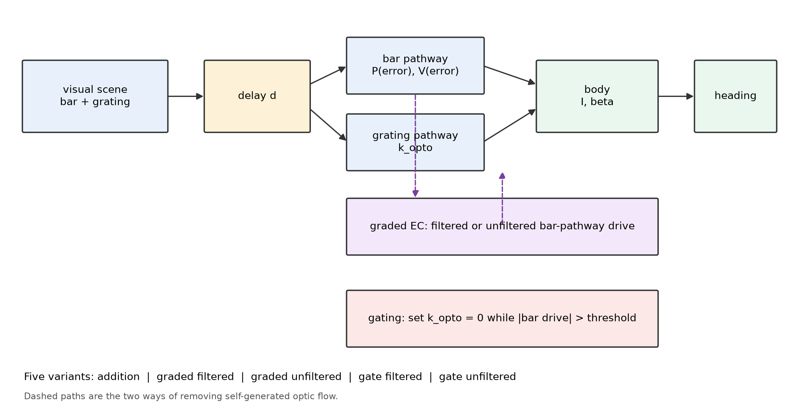
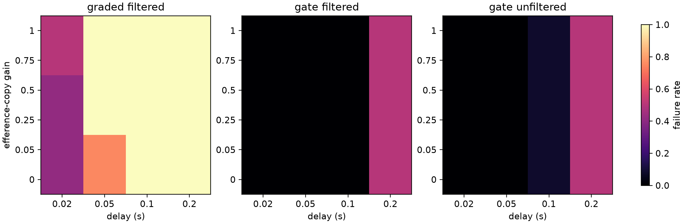

# Efference-copy gain and source determine whether graded cancellation helps or hurts under feedback delay in a model of fly steering

**Manuscript status:** scientific content complete, 2026-10-27. No new biological data. Target: PLOS Computational Biology (B0 computational study); not a Nature flagship submission.

**Authors:** [author list and affiliations to be entered by the owner at submission]

**Correspondence:** [owner-side]

---

## Abstract

Flying insects separate visual motion caused by their own turns from motion caused by the world. This separation is commonly attributed to an efference copy: an internal signal that predicts the visual consequences of a motor command. Two families of models implement the idea. Graded models subtract a continuous prediction of self-generated optic flow; all-or-none models suppress the stabilizing optomotor pathway whenever an object-driven turn is underway. Behavioral evidence in *Drosophila* has favored all-or-none gating under changes in background texture, but we are not aware of a comparison of the two families across efference-copy gains under an explicit transport delay on the visual feedback, a ubiquitous constraint on any real visuomotor loop. Here we extend a published fly-steering model with an explicit delay and compare five variants across efference-copy gains from 0 to 1.0. The results identify two decisive variables. First, gain: at the source model's fixed gain of 0.05, graded cancellation is indistinguishable from no efference copy; at gains of 0.25 or more, delayed sensory cancellation becomes harmful, failing in 100% of parameter sets at 50 ms versus 75% for no efference copy. Second, signal source: a current motor copy at high gain trades short-delay performance for long-delay stability, reducing 200 ms failure from 100% to 25-42%. Binary gating is gain-invariant: delayed sensory gating has 0% failure through 100 ms and 50% at 200 ms, while current motor-copy gating has 8% failure at 100 ms and 50% at 200 ms. An adaptive MLP version of the graded model, which learns the gain online, learns a higher gain as delay increases and does not rescue stability across learning rates from 1e-5 to 1e-3: every rate fails in 100% of parameter sets by 100 ms, and rates of 8e-5 or more fail in 100% at 50 ms, worse than no efference copy (75%). These results reframe the graded-versus-gating debate: the question is not whether graded cancellation is better in principle, but whether its gain and signal source make it inert, harmful, or helpful. The model is deliberately minimal and makes no claim about the mechanism used by the fly; it provides a falsifiable computational target for delayed-feedback experiments.

**Keywords:** efference copy, reafference, optic flow, sensorimotor delay, Drosophila, flight steering

---

## Introduction

An animal that moves through the world creates much of the sensory input it receives. The visual flow produced by a fly's own turn is indistinguishable, at the retina, from the flow produced by an external rotation. Behavioral and physiological work has established that flies solve this problem in part by combining visual signals with motor-related signals. During voluntary turns, horizontal-system cells in the lobula plate receive motor-related inputs with a sign and latency appropriate to suppress the cell's response to the turn (Kim et al., 2015). A visual cell type in the lobula, LT52, receives non-visual feedback about limb movement and is positioned to suppress steering toward the fly's own leg during grooming (Hartman et al., 2025). The computation is therefore not a purely visual one; it depends on an internal prediction of the sensory consequences of action.

How that prediction is used is less clear. One class of models subtracts a graded, continuous estimate of self-generated optic flow from the visual drive. A second class gates the stabilizing pathway off entirely while an object-driven turn is in progress. The distinction is not cosmetic: the two families make different predictions about how the system responds to changes in background texture, to conflicts between object and background motion, and to perturbations of the motor-to-visual loop. Canelo et al. (2024) compared an addition-only model, a graded efference-copy model, and an all-or-none model against behavioral data from tethered flying flies. The all-or-none model accounted for the observed invariance of object-evoked turns across sparse and dense backgrounds; graded cancellation and simple addition did not. That result favors gating under the conditions tested.

The comparison, however, left a major physical constraint out of the main analysis: delay. Any visuomotor loop has a delay between a motor command and the visual feedback it produces, and between the visual signal and the motor response. The source model included a delay block only in a supplementary figure and omitted it from the main simulations. In the source code, that supplementary comparison varies whether the torque is passed through the `tau` filter, not a transport delay on the visual feedback; our delay is therefore a different manipulation. This omission matters because delayed negative feedback is a classic route to oscillation and loss of stability. A graded cancellation signal that is itself delayed can add a second delayed loop to the system; a binary gate can remove the loop entirely while a turn is underway. The two strategies may therefore rank differently when delay is treated as a first-class variable rather than a robustness afterthought.

A second question is what signal the gate or the cancellation uses. An efference copy is usually conceived as a copy of the motor command, available before the sensory consequences arrive. A delayed sensory estimate is a different object: it is a prediction derived from the visual consequences of the action, and it arrives late by construction. The two can have different stability properties even if both are "efference copy" in a loose sense. The source model's graded implementation drives its internal prediction from the bar pathway's torque, which, under a delayed visual input, is itself delayed. Whether that is the right level of description is an empirical question, but it is a question a model can sharpen.

Here we extend the Canelo et al. (2024) model in three ways. First, we add an explicit sensorimotor delay on the visual state. Second, we separate graded cancellation driven by a delayed sensory estimate from graded cancellation driven by a current motor copy. Third, we add a gating variant that uses the current motor copy rather than the delayed sensory estimate. We then ask a narrow question: under a delay, which of these strategies preserves stable steering, and what does the answer depend on? We do not claim to identify the fly's mechanism. We use the model as a computational assay that generates a falsifiable prediction for delayed-feedback experiments.

---

## Results

### A minimal steering model with an explicit feedback delay

We used the flight-simulator equations of Canelo et al. (2024) as the starting point. The fly's heading error is corrected by a bar pathway that responds to the angular position and velocity of a target, and by a grating pathway that responds to wide-field background motion. The body is a second-order yaw system with moment of inertia `I` and drag `beta`. In the source model, the bar torque is low-passed with `tau_bar = 0.05 s`, the grating torque with `tau_opto = 0.04 s`, and the grating gain is `k_opto = 25 x 10^-12 N m` per rad/s. In our implementation, the all-or-none model sets the grating gain to zero whenever the absolute bar torque exceeds `1.5 x 10^-11 N m`.

We introduced a delay `d` by evaluating the visual state at time `t - d`: the bar angle and its derivative, the grating angle and its derivative, the heading, and the angular velocity. The body state and the torque low-pass filters remain at the current time. This is a deliberately simple transport delay; it is not a full delay differential equation treatment, but it captures the essential loop: visual information about the current state arrives late. We compared five variants:

- **addition:** bar and grating torques are summed; no efference copy.
- **graded_sensory:** a fixed-gain graded internal prediction `omega_ec` is driven by the delayed bar torque and subtracted from the grating drive.
- **graded_motor:** the same fixed-gain graded architecture, but `omega_ec` is driven by the current motor-copy bar torque.
- **allnone:** the grating gain is set to zero when the delayed bar torque exceeds threshold.
- **allnone_motor:** the grating gain is set to zero when the current motor-copy bar torque exceeds threshold.

All variants share the same body, sensory time constants, bar and grating stimuli, and integration step. The only differences are the efference-copy architecture and the signal used by the gate.

### Efference-copy gain determines whether graded cancellation is inert, harmful, or helpful

We swept the graded EC gain from 0 to 1.0 at delays of 0.02, 0.05, 0.10, and 0.20 s across 12 parameter sets (1,440 simulations; Fig. 2c). Three regimes appeared. At gain 0 or 0.05, both graded variants were indistinguishable from addition at every delay: at 50 ms, all three failed in 75% of parameter sets. At gains of 0.25 or more, delayed sensory cancellation became harmful: failure at 50 ms rose to 100% (12/12), while addition remained at 75% (9/12). The current motor copy behaved differently: at gains of 0.5 or more it was worse at short delays but better at long delays, reducing 200 ms failure from 100% to 25-42% (3-5/12). Gating was invariant to gain: delayed sensory gating had 0% failure through 100 ms and 50% at 200 ms, while current motor-copy gating had 8% failure at 100 ms and 50% at 200 ms.

These regimes are not a monotonic effect of gain. They reflect two competing consequences of an efference copy: a strong delayed sensory estimate adds a delayed feedback loop, which destabilizes the system, while a strong current motor copy provides a lead signal that helps at long delays but can overshoot at short delays. The source model's fixed gain of 0.05 sits in the inert regime: it is too weak to either help or hurt. This is the first main result: the effect of graded cancellation is not a property of "graded versus gating" alone; it depends on the gain and on what the copy represents.

### An adaptive MLP learns a higher gain and does not rescue delay

To test whether the fixed-gain comparison was unfair to graded cancellation, we implemented the source model's online MLP. The MLP receives the bar torque, has five sigmoid hidden units, and outputs a gain `ro` that scales the efference-copy drive; its weights are updated from the squared error between the actual heading and the ideal bar-only heading. Across 12 parameter sets and four delays, the learned gain rose with delay: 0.38 at 20 ms, 0.75 at 50 ms, 0.97 at 100 ms, and 1.06 at 200 ms (Fig. 2d). The failure rate rose faster than no EC: 42% at 20 ms (same as no EC), 100% at 50 ms (versus 75% for no EC), and 100% at 100 and 200 ms. The adaptive model therefore does not rescue graded cancellation; it converges toward the high-gain regime that the fixed-gain sweep identified as harmful. Gating remained at 0% through 100 ms and 50% at 200 ms.

This result is important because it removes the most obvious objection to the fixed-gain comparison: that a smarter, adaptive controller might learn its way out of the delay problem. In this model, it learns its way into the harmful regime instead.

We repeated the adaptive check across learning rates from `1e-5` to `1e-3` and three seeds (576 simulations; Fig. 2e). Every rate learned a gain that grew with delay, and every rate reached 100% failure by 100 ms. At 50 ms, the slowest rate (`1e-5`) matched no EC (75% failure), while rates of `8e-5` or more failed in 100%. Faster learning reached the harmful regime earlier; no rate rescued stability. The direction of the result is therefore not an artifact of one learning rate.

### At unity gain, delayed sensory cancellation is the most fragile strategy

The gain sweep shows that the source model's fixed gain is inert, so we next asked what happens at unity gain, the high end of the sweep. We swept delay from 0 to 0.30 s in 20 ms steps across 12 parameter sets formed by three inertias, two drags, and two grating gains (768 simulations). At each condition we asked whether the run remained bounded: a failure was defined as a heading excursion greater than one full turn, an angular speed above 100 rad/s, or a non-finite state. At zero delay all four original variants were stable. As delay increased, the variants separated sharply.

At 140 ms, a grid point chosen as a round number near the 150 ms response latency reported by Canelo et al. (2024) — the two quantities are not the same, because the reported latency is a response latency, not a feedback delay — addition and graded_sensory failed in every parameter set (12/12), graded_motor failed in 4/12, and allnone failed in 2/12. The median critical delay — the first delay at which a run failed, censored at 0.30 s — was 0.04 s for addition, 0.03 s for graded_sensory, 0.02 s for graded_motor, and 0.25 s for allnone. The ordering was not a subtle shift in a continuous metric; it was a change in the qualitative regime. Addition and graded_sensory went from bounded to unbounded within a few tens of milliseconds, while allnone remained bounded for most of the tested range.

A finer grid (1 ms resolution from 0 to 100 ms; 10 ms resolution thereafter; 1,815 simulations) over three representative parameter sets sharpened the first-failure estimates (Fig. 2b). The medians were 18 ms for addition, 15 ms for graded_sensory, 10 ms for graded_motor, 110 ms for allnone_motor, and 200 ms for allnone. The ordering was unchanged, and the separation between the graded-sensory and allnone medians was more than an order of magnitude.

The mechanism is visible in the failure curves (Fig. 2). Addition and graded_sensory rise to a failure rate of 1.0 by 0.06 s and stay there. Allnone remains at zero until about 0.12 s, after which failures appear only in particular parameter combinations. Graded_motor is bimodal: some parameter sets fail at 20 ms, while others survive to 0.30 s. The bimodality is not noise; it is a systematic dependence on the body time constant.

### The gating signal matters for large excursions

The robustness sweep added a fifth variant, allnone_motor, and a focused body-time-constant grid with two noise seeds (1,520 simulations). The body time constant `tau_body = I / beta` took values of 3, 6, 12, and 24 ms; the grating gain took values of 25 and 50 pN m per rad/s; delay was sampled at 10 ms resolution to 120 ms and then at 20-50 ms resolution to 300 ms.

The main ordering held. At 140 ms, addition and graded_sensory failed in all 16 parameter-seed combinations, graded_motor in 10/16, allnone in 3/16, and allnone_motor in 12/16. The median critical delays were 0.02 s, 0.02 s, 0.015 s, 0.20 s, and 0.11 s respectively. Under the prespecified large-excursion criterion, the surprise is allnone_motor: gating on the current motor copy was substantially less stable than gating on the delayed sensory estimate. The phase diagram (Fig. 3) shows why. The delayed gate remains closed while the delayed bar torque is above threshold, which covers the turn and its sensory aftermath. The current motor-copy gate opens earlier, while the fly is still turning, and the grating pathway re-enters with a delayed self-motion signal. The early re-entry recreates the delayed feedback loop that the gate was supposed to remove.

This is a concrete, testable claim for large excursions: if a gate is used, its stability depends on the timing of gate release, not only on the threshold. A gate driven by a delayed sensory estimate and a gate driven by a current motor copy are not interchangeable under that criterion, even if both are "all-or-none."

### The gating advantage is criterion-dependent

The failure criterion is a modeling choice, so we reclassified the unity-gain fine-grid runs under heading limits of π, 2π, and 4π and angular-velocity limits of 50, 100, and 200 rad/s. The fast-failing variants were invariant: addition, graded_sensory, and graded_motor had median critical delays of 18, 15, and 10 ms under every criterion. The gating variants were not. Under the strictest criterion (heading > π and |omega| > 50 rad/s), allnone had a median critical delay of 56 ms and allnone_motor 58 ms. Under the prespecified criterion (heading > 2π and |omega| > 100), the values were 200 ms and 110 ms. Under the loosest criterion (heading > 4π and |omega| > 200), both reached the 300 ms censoring limit.

Two conclusions follow. First, the ordering graded < gating is robust: no criterion brought the graded variants anywhere near the gating variants. Second, the size of the gating advantage and the difference between the two gating signals are criterion-dependent. A strict oscillation criterion makes allnone and allnone_motor look similar; a large-excursion criterion separates them. The prespecified criterion is the one used in the main text; the reclassification is reported so that readers can substitute their own definition of failure.

### A source-protocol check explains the zero-delay discrepancy

To ask whether the mismatch with the source's background result is due to the stimulus or to the model, we reran the zero-delay comparison with the source's scaled parameters (`I = 6e-4`, `beta = 1e-1`, `P = 1.0`, `V = 1e-2`), a constant grating angle, and grating gains of 0.05 and 0.7. With a near-zero gate threshold (`1.5e-12`), allnone was invariant (59.956 vs 59.956 degrees). Fixed-gain graded cancellation with unity EC gain was also invariant (59.956 vs 59.956), while a partial EC gain of 0.5 was slightly sensitive (59.923 vs 59.770). Addition was strongly sensitive (59.846 vs 50.846).

The source's ranking is therefore recoverable in a narrow regime: a gate that closes almost immediately, and a graded EC that is not at unity gain. It is not a generic property of the fixed-gain model. This reinforces the scope of the paper: the claim concerns the delay manipulation, not the source's zero-delay background result. It also identifies the EC gain and the gate threshold as two parameters that should be measured, not assumed, in future work.

### Body time constant and grating gain set the boundary

The phase diagram also shows that the allnone boundary is not a single number. At a body time constant of 3-6 ms, allnone tolerates delays up to about 120 ms across both grating gains. At 12-24 ms, failures appear at high grating gain and delays of 140 ms or more. The graded_sensory failure, by contrast, is nearly independent of body time constant: it fails at 9-15 ms in the fine grid and 20-40 ms in the coarse grid. That difference supports the interpretation that graded_sensory's fragility is a property of the efference-copy loop, while allnone's boundary is a property of the body-filter-gate interaction.

A solver-convergence check supports the numerical ordering: halving the integration step changed the gating variants by less than 0.3%, while the fast-failing variants changed by 2-16% near divergence, consistent with a few-millisecond uncertainty in their critical delays. The ordering was unchanged.

Graded_motor sits between these extremes and is the most parameter-sensitive variant. Its failures cluster at larger body time constants and lower drag, where the body integrates the delayed torque for longer. The bimodality in the 20 ms sweep is therefore not a numerical artifact of a single parameter set; it is a boundary that moves with the body time constant.

### Noise does not remove the ordering

The robustness sweep added Gaussian torque noise (standard deviation `1 x 10^-13 N m`) and two seeds per condition. The ordering of the failure curves was unchanged: graded_sensory and addition reached 100% failure at short delays, allnone stayed near zero until 120 ms, and graded_motor and allnone_motor were intermediate. Noise shifted individual trajectories but did not move the qualitative boundaries. The phase diagram for graded_sensory remained nearly uniform across body time constants, while the allnone diagram retained its high-gain, long-delay failure region.

### Linear stability analysis reveals a large-signal effect

To ask whether the delay-induced failures are local instabilities, we linearized the five models around the target (heading equal to the bar angle, zero angular velocity and torques) and solved the characteristic equation `det(λI - A - B exp(-λd)) = 0`, where `A` and `B` are the current and delayed Jacobians (Methods). The linearized critical delays were 29 ms for addition, 31 ms for graded_sensory at gain 0.05, 43 ms at gain 1.0, 300 ms for graded_motor at gain 1.0, and 29 ms for allnone on the open-gate branch (Fig. 6).

The linear analysis reproduces the order of magnitude of the continuous-cancellation failure, but it does not distinguish gating from addition, nor the motor-copy benefit. Those differences are large-signal effects: the gate closes only after the bar torque exceeds threshold, and the motor-copy benefit appears after large excursions. The separation reported in the main text is therefore a nonlinear phenomenon, not a small-perturbation instability. This is a limitation of any local analysis and a reason to report the nonlinear failure curves alongside it.

### Predictions

The model makes four predictions that can be tested without changing the core architecture:

1. **Delayed visual feedback should destabilize graded cancellation before it destabilizes binary gating.** In a preparation where the visual feedback delay can be increased parametrically, a graded-cancellation observer should show oscillations or loss of heading control at shorter delays than an all-or-none observer.
2. **The gate's release timing should matter for large excursions.** A gate driven by a delayed sensory estimate should remain stable longer than a gate driven by a current motor copy under a large-excursion criterion, because the latter reopens the grating pathway before the turn is complete. Under a strict oscillation criterion, the two gates may be indistinguishable.
3. **Body time constant should shift the all-none boundary but not the graded-sensory boundary.** Smaller flies, or conditions that reduce the effective body time constant, should tolerate longer delays under gating; the graded-sensory failure should be comparatively invariant.
4. **Grating gain should interact with the gate boundary.** Higher background contrast or gain should expose the allnone failure region at shorter delays, while leaving the graded-sensory failure largely unchanged.

These predictions are stated at the level of the model. They are not claims about the fly's actual mechanism.

---

## Discussion

The central result is that the effect of a graded efference copy is not a property of "graded versus gating" alone. It depends on the gain of the copy and on whether the copy is a delayed sensory estimate or a current motor signal. At the source model's fixed gain, graded cancellation is inert; at higher gain, a delayed sensory estimate is harmful, while a current motor copy helps at long delays. Gating sidesteps both variables because it does not subtract a continuous signal. This reframes the debate: the question is not which family is better in principle, but which regime a given implementation occupies.

A second result is a separation of timescales at unity gain. Graded sensory cancellation and binary gating are both plausible descriptions of reafference suppression, and at zero delay they can be tuned to produce similar steering. Under delay, they diverge: continuous cancellation adds a delayed loop and loses stability early, while gating removes the loop and remains stable much longer. The result is consistent with the behavioral preference for all-or-none gating reported by Canelo et al. (2024), but it adds a reason that their background-texture experiments could not test. Gating may be favored not only because it explains invariance to background texture, but because it is the strategy that survives the delays inherent in a real visuomotor loop.

A third result is that adaptation is not a fix. The MLP learns a higher gain as delay increases and joins the harmful high-gain regime; this predicts that unconstrained plasticity of an efference-copy gain may be destabilizing under delayed feedback.

A fourth result is that the gating signal is not a detail, but its effect is criterion-dependent. Under the large-excursion criterion, a gate on the delayed sensory estimate outperformed a gate on the current motor copy, even though the motor copy is available earlier and is closer to the classical concept of an efference copy. The reason is timing of release, not timing of onset: an early release reopens the delayed feedback loop while the body is still moving. Under a strict oscillation criterion, the two gates converged, which means the advantage is about preventing large departures rather than about suppressing all oscillations. This suggests that experiments aimed at distinguishing the two gating signals should pre-specify which failure mode matters. It also suggests a design principle for artificial agents: if a binary gate is used to suppress self-generated feedback, the release should be driven by a signal that remains valid until the movement is complete, not by the earliest available motor copy — but the benefit will be visible mainly in large excursions.

The body-time-constant result connects the model to comparative physiology. Smaller flies, or flies at different temperatures, have different effective body dynamics. The model predicts that the allnone boundary should move with body time constant, while the graded-sensory boundary should not. This is a comparative prediction that does not require a new species or a new circuit; it requires the same preparation at different body sizes or temperatures.

The model has clear limits, and one of them is worth stating explicitly. We did not reproduce the sparse/dense background protocol of Canelo et al. (2024). In a zero-delay check with our single-bar, single-grating stimulus, the ratio of peak heading at high versus low grating gain was 0.9148 for addition, 0.9830 for allnone, 0.9996 for graded_motor, and 0.9998 for graded_sensory. In other words, graded cancellation was at least as invariant to grating gain as all-or-none in this simplified setting, which does not reproduce the source's behavioral ranking. A source-protocol check (Results) shows that the ranking is recoverable with a near-zero gate threshold and a sub-unity EC gain, but not as a generic property of the fixed-gain model. We therefore treat the source's background-invariance result as motivation for comparing the model families, not as a validation that our implementation reproduces it. The claim of this paper concerns the delay manipulation, not the zero-delay background result.

The model is also a two-pathway simplification of a circuit that contains many cell types, multiple motion pathways, and nonlinear dendritic processing. The bar and grating pathways are phenomenological; the parameters are taken from a published model and not fitted to new data. The delay is a simple transport delay, not a distribution of delays; real sensorimotor loops have distributed latencies. The failure criterion is a modeling choice (one full turn or 100 rad/s), not a biological criterion. The model has no learning, no adaptation, and no state estimation beyond the two pathways. It does not include the fly's head or neck dynamics, the halteres, or the descending pathways that connect the lobula plate to the wing and leg motor systems.

These limits bound the claims. The model does not say that the fly uses all-or-none gating; it says that if the fly uses a gating strategy, the stability of that strategy under delay depends on the gate's release timing. The model does not say that graded cancellation is impossible; it says that a graded cancellation signal derived from a delayed sensory estimate is fragile, and that a graded motor-copy signal is more robust but still parameter-sensitive. The model does not replace an experiment; it tells us which experiment would be decisive.

The relation to the broader connectome-to-behavior literature is indirect. Recent work has asked whether connectome-constrained models reproduce behavior, whether behavior is sufficient evidence for biological fidelity, and whether lesion phenotypes can distinguish biological wiring from degree-matched nulls (Brunton et al., 2026; FlyHack, 2026; Connectome Wiring Shapes Motor Lesion Phenotypes, 2026). Our model is not connectome-constrained. It is a low-dimensional assay of a computational motif. Its value is that it isolates a variable — feedback delay — that is easy to manipulate in experiment and easy to miss in a static model comparison. It could be used as a prior for a connectome-constrained model, or as a null model against which a more detailed model's delay robustness is compared.

A first next step is to reproduce the source's sparse/dense background protocol with the same stimuli and check whether the zero-delay ranking is recovered; we did not attempt it here because the paper's question is about delay, but it would separate "the model is wrong" from "the stimulus is different." A second next step is to implement the source's adaptive graded model, in which an online MLP learns the grating gain, and ask whether adaptation rescues graded cancellation under delay. Our graded variants are fixed-gain; an adaptive controller could in principle learn to compensate for the delay, and our conclusions do not cover that case. A second next step is to replace the phenomenological bar and grating pathways with a connectome-constrained visual front-end, such as the flyvis model (Lappalainen et al., 2024), and to embed the controller in an embodied simulation (Wang-Chen et al., 2024). That would test whether the stability ordering survives a more realistic visual system. A second next step is to fit the model to delayed-feedback behavioral data, if such data become available. The model's predictions are stated precisely enough to be falsified by either step.

---

## Methods

### Model

The model follows the flight-simulator equations of Canelo et al. (2024). The state is the fly heading `psi`, angular velocity `omega`, bar torque `F_bar`, and grating torque `F_grating`. For the graded variants, an additional state `omega_ec` represents the efference-copy prediction.

The body is a second-order yaw system:

```text
dpsi/dt = omega
domega/dt = (-beta * omega + F_bar + F_grating) / I
```

The bar pathway is:

```text
error = wrap(theta_bar - psi)
P(error) = 10e-11 * sin(error)
V(error) = 1e-12 * max(0, 20 - 2 * error^2)
dF_bar/dt = (-F_bar + P(error) + (dtheta_bar - omega) * V(error)) / tau_bar
```

The `max(0, ...)` in `V` is our numerical boundary. The source uses the unclipped form, which becomes negative for `|error| > sqrt(10)` rad and can produce numerical divergence outside the small-error regime; the clip is not a biological claim.

The grating pathway is:

```text
dF_grating/dt = (-F_grating + (dtheta_grating - omega) * k_opto) / tau_opto
```

For graded variants, the grating drive becomes `dtheta_grating + omega_ec - omega`, and:

```text
domega_ec/dt = (-beta * omega_ec + F_bar) / I          (graded_sensory)
domega_ec/dt = (-beta * omega_ec + F_bar_motor) / I    (graded_motor)
```

where `F_bar_motor` is the bar torque computed from the current, undelayed visual state. For allnone, `k_opto` is set to zero while `|F_bar| > 1.5e-11`; for allnone_motor, the gate uses `|F_bar_motor| > 1.5e-11`.

### Delay

The delay is implemented by evaluating the visual state at `t - d` for the bar angle, grating angle, heading, and angular velocity. The body state and the torque filters are evaluated at the current time. The delayed values are stored in a ring buffer at the integration step; the delay is rounded to the nearest step. This is a transport delay, not a distributed latency.

### Stimuli

The bar is a sigmoidal target turn of 60 degrees starting at 0.5 s with slope 30; the grating is a 30-degree sigmoidal background turn in the opposite direction starting at 0.75 s. The stimuli are deterministic. In the robustness sweep, Gaussian torque noise with standard deviation `1e-13 N m` is added to the angular acceleration.

### Simulation and failure criteria

The model is integrated with forward Euler at `dt = 1e-4 s` for 2.5 s. If the state becomes non-finite, the run is truncated and marked as a failure. A run is also a failure if the absolute heading exceeds `2*pi` radians or the absolute angular velocity exceeds 100 rad/s. The failure threshold is a modeling choice; it is reported so that readers can substitute their own.

### Sweeps

The gain sweep crossed five models, six EC gains (0, 0.05, 0.25, 0.5, 0.75, 1.0), four delays (0.02, 0.05, 0.10, 0.20 s), and 12 parameter sets (1,440 runs). The first delay sweep crossed four models (addition, graded_sensory, graded_motor, allnone), 12 parameter sets (three inertias `6e-14, 1.2e-13, 2.4e-13`, two drags `1e-11, 2e-11`, two grating gains `25e-12, 50e-12`), and 16 delays from 0 to 0.30 s in 20 ms steps (768 runs). The robustness sweep crossed five models, eight parameter sets (four body time constants at 3, 6, 12, and 24 ms; two grating gains), 19 delays (10 ms resolution to 120 ms, then 20-50 ms resolution to 300 ms), and two noise seeds (1,520 runs). Code and outputs are in the repository.

### Adaptive MLP

The adaptive variant follows the source model's `sim_effc`. A five-unit sigmoid MLP receives the bar torque `F_bar`, outputs a gain `ro`, and is updated at each simulation step from the squared error between the actual heading and the ideal bar-only heading. The ideal trajectory is computed with the same delay and no grating. We clip `ro` to `[0, 2]` for numerical stability. The adaptive check crossed 12 parameter sets, four delays, and five comparison models (adaptive, fixed gain 0.05, fixed gain 1.0, addition, allnone; 240 runs). A robustness sweep crossed four learning rates (`1e-5`, `8e-5`, `5e-4`, `1e-3`), three seeds, four delays, and 12 parameter sets (576 runs). This is an explicit step-wise approximation of the source's ODE-internal update; the approximation is disclosed.

### Threshold reclassification

To test the dependence on the failure criterion, we re-read the fine-grid CSV and recomputed the first failing delay under heading limits of π, 2π, and 4π and angular-velocity limits of 50, 100, and 200 rad/s. No new simulations were run; this is a post-hoc reclassification of the same trajectories. The main text uses the prespecified criterion (heading > 2π or |omega| > 100 rad/s). The reclassification table is in `threshold_sensitivity.json`.

### Solver convergence

We compared forward Euler at `dt = 1e-4 s` with `dt = 5e-5 s` for five representative conditions. The gating variants differed by less than 0.3% in maximum heading and angular velocity. The fast-failing variants differed by 2-16% near divergence, so their critical-delay estimates carry a few-millisecond uncertainty. The ordering of the variants was unchanged. A full delay differential equation treatment is left for future work.

### Linear stability

We linearized each model around the target (heading equal to the bar angle, zero angular velocity and torques) to obtain `x_dot = A x(t) + B x(t - d)`, where `A` contains the current-state terms and `B` the delayed-state terms. The characteristic equation `det(λI - A - B exp(-λd)) = 0` was solved numerically for the rightmost root by continuation from the `d = 0` eigenvalues, using SciPy's root finder; the critical delay is the first `d` at which the rightmost real part becomes positive. The all-or-none gate is non-smooth, so we analyzed the open-gate branch; the closed-gate and large-signal behavior is not captured by this local analysis and is reported from the nonlinear simulations.

### Statistics

The primary quantity is the failure rate at a given delay, computed over parameter sets and seeds. The critical delay is the first delay at which a run fails, censored at the maximum tested delay. We report medians and means; no inferential test is applied because the parameter grid is a design, not a random sample. The phase diagrams show failure rate as a function of body time constant and delay.

### Code and data availability

All code is in `M2A-BRIDGE/06_JOINT/` (`ec_model.py`, `run_delay_sweep.py`, `run_robustness.py`, `test_ec_model.py`). Outputs are in `runs/P1-EC-DELAY-01/experiment/outputs/` and `runs/P1-EC-DELAY-02/experiment/outputs/`. No new biological data were generated. The equations are ported from the published flight-simulator code accompanying Canelo et al. (2024); the MATLAB source is at https://github.com/nisl-hyu/flightsim.

---

## Figure legends

{width=95%}

**Fig. 1 | Model and delay manipulation.** Schematic of the bar and grating pathways, the body, and the five efference-copy variants. The delay `d` is applied to the visual state; the body and torque filters are current. Source: `fig1_model.png`.

{width=70%}

**Fig. 2 | Failure rate versus feedback delay.** Failure rate across 12 parameter sets (P1 sweep) for addition, graded_sensory, graded_motor, and allnone. A failure is heading > 2π or |omega| > 100 rad/s. Source: `fig2_failure_rate_vs_delay.png`.

{width=70%}

**Fig. 2b | Critical delays at 1 ms resolution.** First failing delay for five variants across three representative parameter sets; horizontal bars are medians (18, 15, 10, 110, and 200 ms). Source: `fig2b_critical_delays.png`.

{width=95%}

**Fig. 2c | Efference-copy gain by delay.** Failure rate for graded_sensory, allnone, and allnone_motor across EC gains (0, 0.05, 0.25, 0.5, 0.75, 1.0) and delays (0.02, 0.05, 0.10, 0.20 s). At gain 0 or 0.05, graded_sensory is indistinguishable from no EC; at gains of 0.25 or more, it is worse at 50 ms. Gating is gain-invariant. Source: `fig2c_gain_delay_heatmap.png`.

{width=90%}

**Fig. 2d | Adaptive MLP versus fixed gains.** Failure rate (left) and learned EC gain (right) across delays for the adaptive MLP, fixed graded gains 0.05 and 1.0, no EC, and delayed sensory gating. The adaptive model learns a higher gain as delay increases and fails in 100% of parameter sets at 50 ms. Source: `fig2d_adaptive.png`.

{width=90%}

**Fig. 2e | Adaptive MLP across learning rates.** Failure rate (left) and mean learned gain (right) for learning rates `1e-5` to `1e-3` and three seeds. Every rate reaches 100% failure by 100 ms; faster rates fail earlier. Source: `fig2e_adaptive_alpha.png`.

{width=90%}

**Fig. 3 | Phase diagram.** Failure rate as a function of body time constant `I/beta` and delay for graded_sensory and allnone, with noise and two seeds (P2 sweep). Source: `fig3_phase_diagram.png`.

{width=80%}

**Fig. 4 | Example trajectories at 140 ms.** Heading versus time for the five variants at a 140 ms delay with noise, one representative parameter set. Source: `fig4_example_trajectories.png`.

{width=70%}

**Fig. 5 | Gating signal comparison.** Failure rate versus delay for allnone and allnone_motor, showing that the delayed sensory gate is more stable than the current motor-copy gate. Source: `fig5_gating_signal.png`.

{width=80%}

**Fig. 6 | Linear stability analysis.** Rightmost real eigenvalue of the linearized delayed system versus delay for addition, graded sensory (gains 0.05 and 1.0), graded motor (gain 1.0), and allnone on the open-gate branch. Dotted vertical lines mark the first zero crossing. The open-gate linearization does not capture the gating or motor-copy benefits, which are large-signal effects. Source: `fig6_linear_stability.png`.

---

## Limitations

- The model is a toy model; it is not connectome-constrained and does not include the fly's actual visual circuit.
- Parameters are taken from Canelo et al. (2024) and not fitted to new data.
- The delay is a simple transport delay; real sensorimotor delays are distributed and state-dependent.
- The failure criterion is a modeling choice.
- No new biological data; the predictions are untested.
- The model does not include learning, adaptation, head/neck dynamics, halteres, or descending motor pathways.
- The model does not claim that the fly uses any of the five variants.
- The adaptive MLP is updated at the simulation step, not inside an ODE solver as in the source; the full source ODE-internal update is future work. Within this approximation, adaptation learns a higher gain and does not rescue delay.
- The fixed-gain variants are the main comparison; the adaptive variant is a robustness check, not a claim that all adaptive controllers behave this way.
- The zero-delay background-gain check does not reproduce the source's ranking of graded versus all-or-none; the source's behavioral result is motivation, not a validation of this implementation.

---

## References

1. Canelo, A., Kim, Y., Park, J. & Kim, A. J. A visual efference copy-based navigation algorithm in Drosophila for complex visual environments. *eLife Reviewed Preprint* 93487 (2024). https://doi.org/10.7554/eLife.93487
2. Kim, A. J., Fitzgerald, J. K. & Maimon, G. Cellular evidence for efference copy in Drosophila visuomotor processing. *Nature Neuroscience* **18**, 1247-1255 (2015). https://doi.org/10.1038/nn.4083
3. Hartman, A. K. et al. A cell type in the visual system that receives feedback about limb movement. *Current Biology* **35**, 3697-3709.e4 (2025). https://doi.org/10.1016/j.cub.2025.06.055
4. Erginkaya, M. et al. A competitive disinhibitory network for robust optic flow processing in Drosophila. *Nature Neuroscience* **28**, 1241-1255 (2025). https://doi.org/10.1038/s41593-025-01948-9
5. Lappalainen, J. K. et al. Connectome-constrained networks predict neural activity across the fly visual system. *Nature* **634**, 1132-1140 (2024). https://doi.org/10.1038/s41586-024-07939-3
6. Wang-Chen, S. et al. NeuroMechFly v2: simulating embodied sensorimotor control in adult Drosophila. *Nature Methods* **21**, 2353-2362 (2024). https://doi.org/10.1038/s41592-024-02497-y
7. Westeinde, E. A. et al. Transforming a head direction signal into a goal-oriented steering command. *Nature* (2024). https://doi.org/10.1038/s41586-024-07039-2
8. Bates, A. S. et al. Distributed control circuits across a brain-and-cord connectome. *Nature* (2026). https://doi.org/10.1038/s41586-026-10735-w
9. Dhawan, A. FlyHack: Stress-testing mechanistic claims in a connectome-constrained visual model. arXiv:2610.13018 (2026).
10. Brunton, B. W., Abe, E. T. T., Hu, L. J. & Tuthill, J. C. The digital sphinx: Can a worm brain control a fly body? bioRxiv (2026). https://doi.org/10.64898/2026.03.20.713233
11. von Holst, E. & Mittelstaedt, H. Das Reafferenzprinzip. *Naturwissenschaften* **37**, 464-476 (1950).
12. Dhiman, N. Topological sensitivity in connectome-constrained neural networks. arXiv:2604.04033 (2026).

---

## Supplementary note: what this manuscript is not

This is a computational study. It does not report a new biological mechanism, a new animal experiment, or a new connectome. It does not claim that the fly uses all-or-none gating. It does not claim that graded cancellation is biologically impossible. It is a model-based argument that feedback delay is a first-class variable in the graded-versus-gating debate, and that the gate's release timing is a second variable. Both claims are falsifiable with delayed-feedback experiments.
